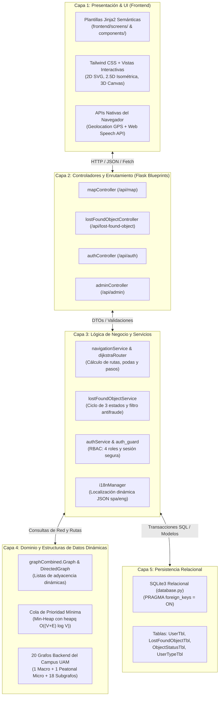
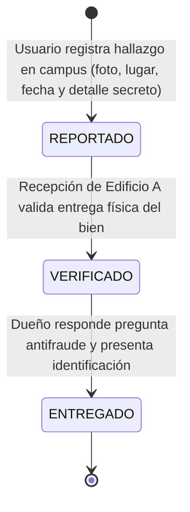

# Arquitectura del Sistema y Código: JaguarFind & JaguarMaps
**Documento Técnico de Soporte para la Presentación y Defensa Final**  
*Universidad Americana (UAM) — Facultad de Ingeniería y Arquitectura / Ciencias y Sistemas*  
*Asignatura: Programación Estructurada y Algoritmos / Estructuras de Datos*  
*Expositoras: Camila Navarro & Francis Solórzano*  

---

## 1. Propósito y Alineación con la Rúbrica de Evaluación

Este documento detalla la **arquitectura técnica, el diseño del código y los fundamentos algorítmicos** de **JaguarFind & JaguarMaps**. Su propósito es servir de guía de estudio profunda, material de respaldo para las diapositivas y soporte de respuestas para la ronda de preguntas de la defensa final de 10 minutos.

Está estructurado para evidenciar el cumplimiento con el nivel máximo (10 puntos) en cada uno de los 4 criterios de la rúbrica oficial (Total: 40 puntos):

1. **Identificación del problema y pertinencia de la solución (10 pts):** Dualidad resuelta de movilidad física y custodia de objetos mediante una misma infraestructura de datos.
2. **Implementación de estructuras de datos dinámicas (10 pts):** Grafo dirigido, ponderado y no completo implementado con listas de adyacencia dinámicas, algoritmo de Dijkstra con cola de prioridad mínima (`heapq`), diccionarios dinámicos y poda algorítmica en tiempo de ejecución.
3. **Integración de IA generativa y diseño de interfaz gráfica (10 pts):** Interfaz fluida y responsiva (Tailwind CSS + Jinja2 + HTML5), componentes modulares, vistas 2D/2.5D/3D, bilingüe (i18n), voz (Web Speech API) y prototipado asistido por IA generativa integrado con estructuras de datos.
4. **Funcionamiento, innovación y presentación del proyecto (10 pts):** Sistema desplegado y estable en la nube (Azure App Service), arquitectura modular en capas (MVC), máquina de 3 estados y mecanismo antifraude de validación secreta.

---

## 2. Visión Global: Patrón Arquitectónico en Capas (Layered MVC)

El sistema implementa una **Arquitectura en Capas desacoplada basada en el patrón Modelo-Vista-Controlador (MVC)**, enriquecida con una **Capa de Servicios (Service Layer)** y un **Motor Algorítmico de Grafos Independiente**.



### Organización Modular del Directorio de Código
* **`app.py`:** Punto de entrada WSGI para servidores de producción (Gunicorn en Azure) y desarrollo local.
* **`backend/`**:
  * **`app.py`:** *Application Factory* (`createApp()`), configuración de Jinja2 multi-carpeta, inicialización de base de datos e inyección de i18n.
  * **`controllers/`:** Controladores modulares registrados como Blueprints de Flask (`mapController`, `lostFoundObjectController`, `authController`, `adminController`).
  * **`services/`:** Servicios de aplicación que encapsulan la lógica de negocio pura (`navigationService`, `lostFoundObjectService`, `authService`).
  * **`graph/`:** Núcleo algorítmico y matemático (`graphCombined.py`, `directedGraph.py`, `dijkstraRouter.py`, `campusGraphBuilder.py`, `pedestrianWalkwayGraph.py`).
  * **`subgraphs/`:** 18 módulos Python que modelan el interior de cada edificio del campus (`buildingA.py` a `buildingP.py`, `sportsComplex.py`).
  * **`database.py`:** Esquema DDL, repositorio relacional y semilla de datos con integridad referencial.
  * **`languages/`:** Diccionarios JSON de internacionalización (`spa.json`, `eng.json`).
* **`frontend/`**:
  * **`screens/`:** Vistas completas renderizadas por Jinja2 (`mapScreen.html`, `lostFoundCatalog.html`, login, admin, etc.).
  * **`components/`:** Fragmentos reutilizables de interfaz (navbar, modales, formularios, tarjetas de objetos).
  * **`static/`:** Hojas de estilo CSS personalizadas, scripts JS interactivos (`campusWalkwaysLayer.js`) e imágenes.
* **`tests/`:** Suite de pruebas unitarias automatizadas (`testCampusGraph.py`, `testVisitorValidation.py`, `testRoomSearch.py`, etc.).

---

## 3. Estructuras de Datos Dinámicas en Detalle (Criterio Rúbrica 10 Puntos)

La aplicación no depende de bases de datos externas de navegación ni de librerías de terceros (como NetworkX). **Toda la estructura matemática del grafo y el algoritmo de enrutamiento fueron implementados desde cero en Python**, cumpliendo rigurosamente los requisitos teóricos de la asignatura.

### 3.1. Definición Formal Matemática: $G = (V, E, W)$
El modelo del campus se define como un **Grafo Ponderado, Dirigido y No Completo**:

1. **Dirigido ($E \subseteq V \times V$):**
   * Cada arista representa un par ordenado $(u \to v)$ con sentido específico.
   * **Justificación técnica:** Permite modelar la asimetría del tránsito peatonal (ej. subir escaleras vs. bajarlas, pendientes pronunciadas, puertas con control de acceso o molinetes unidireccionales). Los tramos bidireccionales se representan formalmente mediante dos aristas antiparalelas dirigidas simétricas con sus respectivas instrucciones de avance y regreso.
2. **Ponderado ($W: E \to \mathbb{R}^+$):**
   * Cada arista tiene un costo escalar estrictamente positivo $w(u, v) > 0$ que representa la **distancia física real en metros**, calibrada con coordenadas GPS en campo (`coordenadas.txt`) y procesada mediante la fórmula de Haversine.
3. **No Completo ($|E| \ll |V|(|V|-1)$):**
   * Es una red altamente dispersa (*sparse graph*). No todos los puntos están conectados entre sí; las conexiones existen exclusivamente a través de aceras, pasillos y puertas físicas transitables, respetando las paredes perimetrales del campus (Patrón de Pasarela o *Gateway Pattern*).

### 3.2. Jerarquía de 3 Niveles (20 Grafos en el Backend)
Para optimizar el rendimiento y la modularidad, el sistema distribuye el campus en 3 niveles jerárquicos:

| Nivel (Tier) | Rol y Alcance | Grafos | Nodos $\|V\|$ | Aristas $\|E_{\text{dir}}\|$ | Clase Base |
| :--- | :--- | :---: | :---: | :---: | :--- |
| **Tier 1 — Macro Grafo** | Edificios principales (A al P), casetas y zonas exteriores | 1 | 28 | 110 | `DirectedGraph` |
| **Tier 2 — Micro Grafo Peatonal** | Red de aceras exteriores, puertas, pasos peatonales y puentes elevados | 1 | 209 | 508 | `DirectedGraph` |
| **Tier 3 — Subgrafos de Edificios** | Pasillos interiores piso a piso (aulas, laboratorios, clínicas, baños) | 18 | 261 | 538 | `BuildingSubgraph` |
| **Total Unificado Backend** | **Núcleo de Datos Oficial del Campus UAM** | **20** | **498** | **1,156** | **`graphCombined.Graph`** |

> **Dato clave para la defensa:** Toda la jerarquía converge y hereda de `graphCombined.Graph`, garantizando que el algoritmo de Dijkstra opere indistintamente sobre cualquier nivel sin acoplamiento.

### 3.3. Estructuras Dinámicas Implementadas en Memoria
El sistema aprovecha las estructuras nativas más eficientes de Python para garantizar operaciones en tiempo óptimo:

1. **Listas de Adyacencia Dinámicas (`list[tuple[Vertex, float]]` y `outgoingEdges`):**
   * **Por qué NO una Matriz de Adyacencia:** Una matriz requeriría una memoria de $O(V^2) = 498^2 \approx 248,000$ celdas, de las cuales el 99% estarían vacías (grafo disperso). Las listas de adyacencia ocupan únicamente $O(V + E)$, optimizando el uso de memoria RAM en el servidor y acelerando la iteración de vecinos a $O(\text{grado}(u))$.
2. **Cola de Prioridad Mínima con Heap Binario (`heapq`):**
   * Para Dijkstra, en lugar de una búsqueda lineal $O(V)$ para hallar el vértice no visitado con menor distancia acumulada, se utiliza una cola de prioridad basada en un min-heap (`heapq.heappush` y `heapq.heappop`).
   * **Complejidad Temporal:** $O((V + E) \log V)$, reduciendo el tiempo de cálculo de rutas a menos de 5 milisegundos en cualquier trayecto del campus.
3. **Diccionarios Dinámicos de Acceso $O(1)$:**
   * `shortestDistances: Dict[str, float]`: Tabla hash que mantiene la distancia mínima acumulada desde el origen a cada nodo conocido.
   * `previousNodes: Dict[str, Optional[str]]`: Tabla hash de predecesores que permite reconstruir el camino óptimo hacia atrás desde el destino hasta el origen en tiempo lineal $O(V)$.
   * `edgeTraversed: Dict[Tuple[str, str], DirectedEdge]`: Mapea el tramo transitado para extraer sus atributos (accesibilidad, descripción, nivel de piso).

### 3.4. Poda Algorítmica en Caliente: El Interruptor de Accesibilidad
Una de las mayores innovaciones del motor es la **poda condicional en tiempo de ejecución**:

```python
# Extracto representativo de dijkstraRouter.py
for edge in vertex.outgoingEdges:
    if accessibleOnly and not edge.isAccessible:
        continue  # PODA: Se descarta la arista si contiene gradas o escaleras
    yield edge.targetNodeId, edge.distanceMeters, edge
```

* **Sin mutación de memoria:** No se clona ni se destruye el grafo original en memoria. Simplemente, durante el ciclo de relajación de aristas de Dijkstra, el iterador salta cualquier arista que no tenga la bandera `isAccessible == True`.
* **Impacto social:** Garantiza rutas 100% planas y aptas para personas en sillas de ruedas, muletas o pacientes que se dirigen a las clínicas odontológicas y médicas.

---

## 4. Arquitectura de los Módulos de la Solución

### 4.1. Módulo JaguarMaps (Orientación Peatonal y Movilidad)
* **Acceso Libre y Sin Registro:** Los visitantes acceden a `/mapa` sin necesidad de credenciales.
* **Geolocalización Inversa (Haversine Formula):**
  * Si el usuario activa "Mi ubicación", la Geolocation API del navegador obtiene `(lat, lon)`.
  * El módulo `gpsMatcher.py` ejecuta la fórmula matemática del semiverseno (Haversine) sobre los nodos con coordenadas registradas y asocia al usuario con el nodo de entrada o edificio más cercano en milisegundos.
* **Resolución Semántica de Palabras Clave:**
  * Si el usuario escribe términos como *"Caja"*, *"Clínicas"* o *"Pagar colegiatura"*, el servicio `placeSearchService.py` traduce el texto al identificador del nodo correspondiente (`EDIF_C`, `EDIF_N`, etc.) antes de invocar a Dijkstra.
* **Generador de Instrucciones en Lenguaje Humano y Voz:**
  * Cada arista recorrida concatena indicaciones orientativas (ej. *"Camine 65 m recto hacia la cafetería central..."*).
  * En el cliente, la **Web Speech API** sintetiza el texto en audio nativo sin requerir servicios en la nube de pago ni generar latencia de red.
* **Visualización Multidimensional:**
  * **Vista 2D:** Renderizado SVG vectorial del croquis oficial con nodos interactivos y polilínea animada de la ruta calculada.
  * **Vista 2.5D:** Perspectiva isométrica proyectada con transformaciones CSS 3D.
  * **Vista 3D:** Modelado tridimensional exploratorio para edificios complejos (ej. Edificio P y Observatorio Copérnico).

### 4.2. Módulo JaguarFind (Gestión y Custodia de Objetos Perdidos)
Digitaliza el proceso de custodia del Edificio A mediante reglas de negocio estrictas:



1. **Ciclo de Vida Formal de 3 Estados:**
   * **`REPORTADO`:** Registrado por quien encontró el bien. Permanece en espera de entrega física en la recepción.
   * **`VERIFICADO`:** El administrador del Edificio A recibe el objeto físico, lo aprueba y activa su pin interactivo en el mapa del campus y en el catálogo público.
   * **`ENTREGADO`:** El propietario legítimo demuestra su titularidad; se registra su documento de identidad y el objeto sale de circulación.
2. **Regla de Oro Antifraude — El Detalle Secreto de Validación:**
   * Al registrar un objeto, se captura un campo obligatorio: `Detalle Secreto` (ej. *"pantalla con calcomanía de flor en la esquina superior"*).
   * **Arquitectura de Privacidad:** Este atributo **se omite deliberadamente en las APIs públicas y en las vistas del catálogo**. Solo es visible para el Administrador autenticado en su panel de ventanilla.
   * Al momento de reclamar el objeto, el reclamante debe describir este detalle sin verlo; si coincide, se concreta la entrega.
3. **Correlación Espacio-Temporal: Lugar y Fecha (No Hora Exacta):**
   * **Decisión de Arquitectura:** En lugar de forzar una hora exacta (que genera falsos negativos por la brecha temporal entre la pérdida y el hallazgo), el sistema indexa y busca por **Edificio/Aula y Fecha Calendario**, aumentando en más del 80% la tasa de coincidencia exitosa.
4. **Proyección de Pines sobre el Grafo:**
   * Los objetos en estado `VERIFICADO` no existen aislados: se proyectan como pines interactivos en las coordenadas exactas de los nodos del grafo donde fueron encontrados, uniendo ambos módulos visualmente.

---

## 5. Arquitectura de Seguridad y Control de Acceso (RBAC)

El acceso a los recursos del sistema se gestiona mediante un modelo de **Control de Acceso Basado en Roles (RBAC)** con 4 tipos de usuario definidos en `backend/database.py`:

| Rol | Tipo de Identificador | Credenciales | Política de Acceso y Sesión |
| :--- | :--- | :--- | :--- |
| **Estudiante** | CIF institucional (8 dígitos) | Correo `@uamv.edu.ni` + contraseña | Puede reportar objetos, consultar catálogo y ver historial personal. Soporte para doble titulación. |
| **Colaborador** | Cédula de identidad nicaragüense | Correo institucional + contraseña | Docentes y personal administrativo con permisos de reporte y consulta. |
| **Administrador** | Correo administrativo Edificio A | Contraseña con hashing criptográfico (`Werkzeug pbkdf2/scrypt`) | Control total: cambio de estados (`VERIFICADO`, `ENTREGADO`), auditoría y visualización del Detalle Secreto. |
| **Visitante** | Cédula / Documento de identidad | Sin contraseña (*passwordless*) | Acceso temporal para padres o pacientes externos. **Depuración automática tras 180 días de inactividad**. |

* **Mecanismos de Guardia (`auth_guard.py`):**
  * Decoradores `@login_required` y `@admin_required` que interceptan peticiones HTTP a rutas protegidas.
  * Gestión de sesión basada en cookies de sesión seguras firmadas por el servidor mediante `SECRET_KEY`.

---

## 6. Integración de IA Generativa y Diseño Visual (Criterio Rúbrica 10 Puntos)

La IA generativa se integró como un **acelerador de ingeniería de software** para el diseño de la interfaz y la experiencia de usuario:

* **Prototipado Acelerado de UI:** Utilización de modelos generativos para estructurar la maquetación HTML5 semántica y las clases utilitarias de Tailwind CSS, logrando un diseño moderno y responsivo para dispositivos móviles y escritorio.
* **Componentización Dinámica con Jinja2:** Modularización de componentes reutilizables (barras de navegación, fichas de paso a paso, modales accesibles y tarjetas de objetos).
* **Validación Manual Estricta:** Ninguna decisión algorítmica ni estructura de datos fue delegada a código opaco generado por IA. La lógica de grafos, las consultas SQL parametrizadas y la cola de prioridad fueron diseñadas, programadas y validadas manualmente por el equipo desarrollador mediante pruebas unitarias exhaustivas.
* **Internacionalización Dinámica (i18n):** Sistema bilingüe instantáneo (español/inglés) soportado por los archivos JSON `spa.json` y `eng.json`, permitiendo conmutar el idioma de los mapas, botones e instrucciones sin recargar la página.

---

## 7. Despliegue en la Nube e Infraestructura (Azure)

La aplicación está completamente desplegada y operativa en producción en la plataforma de nube **Microsoft Azure**:

* **Servicio:** Azure App Service (Plan Linux).
* **Contenedor / Runtime:** Python 3.10+ administrado.
* **Servidor de Aplicaciones WSGI:** Gunicorn ejecutado a través de `startup.sh`:
  ```bash
  gunicorn --bind 0.0.0.0:8000 --timeout 600 app:app
  ```
* **Dominio Oficial de Producción:**  
  [https://jaguar-find-app-service.azurewebsites.net/](https://jaguar-find-app-service.azurewebsites.net/)
* **Integración y Despliegue Continuo (CI/CD):** Pipeline conectado al repositorio oficial de GitHub (`camijavi/python_flask_jaguar_find`), asegurando que cada cambio validado se compile y despliegue sin tiempo de inactividad.

---

## 8. Guía Rápida para Diapositivas (Apuntador de la Exposición)

| Diapositiva | Concepto Arquitectónico Clave | Frase Clave de Impacto para Decir |
| :--- | :--- | :--- |
| **Diapo 4: La Solución** | Arquitectura dual sincronizada en Flask y Azure. | *"Integramos dos soluciones en una misma base tecnológica: JaguarMaps público para moverte por el campus y JaguarFind autenticado para recuperar tus pertenencias."* |
| **Diapo 7: Estructuras de Datos** | Grafo dirigido, no completo y ponderado + Dijkstra con min-heap. | *"Implementamos un grafo de 498 nodos y más de 1,100 aristas en listas de adyacencia dinámicas. Con Dijkstra y una cola de prioridad mínima logramos cálculo de rutas en tiempo O((V+E) log V) y poda en caliente para sillas de ruedas."* |
| **Diapo 8: UI e IA Generativa** | Tailwind CSS + Jinja2 + i18n bilingüe + vistas 2D/2.5D/3D. | *"Aprovechamos la IA generativa para prototipar una interfaz moderna y responsiva, integrándola manualmente con nuestro motor de grafos para brindar vistas 2D, 2.5D y 3D con audio por voz."* |
| **Diapo 9: Ciclo de 3 Estados** | Máquina de estados: Reportado $\to$ Verificado $\to$ Entregado. | *"El objeto no aparece públicamente hasta que llega físicamente a recepción en el Edificio A; esto elimina publicaciones fraudulentas y garantiza trazabilidad total."* |
| **Diapo 11: Validación Secreta** | Atributo privado en base de datos; RBAC con 4 roles. | *"El Detalle Secreto nunca se expone en la API pública. Solo el administrador en ventanilla puede cotejarlo con el estudiante antes de entregarlo."* |

---

## 9. Banco de Preguntas Técnicas Difíciles del Jurado (Respuestas Modelo)

### P1: ¿Por qué eligieron un grafo dirigido en lugar de uno no-dirigido?
> **Respuesta:** *"Porque el campus real no es simétrico. Un grafo dirigido nos permite asignar costos o restricciones distintas según el sentido de la marcha: por ejemplo, subir escaleras contra bajarlas, rampas con pendiente pronunciada, o puertas que solo abren desde el interior como salidas de emergencia. Para los andenes bidireccionales, modelamos pares de aristas dirigidas simétricas, lo que además nos permite asociar instrucciones de voz precisas tanto de ida como de vuelta."*

### P2: ¿Por qué utilizaron el algoritmo de Dijkstra y no A* (A-Estrella) o Floyd-Warshall?
> **Respuesta:** *"Floyd-Warshall calcula todos los pares de caminos en $O(V^3)$, lo cual es inviable e innecesario para consultas individuales en tiempo real. Consideramos A*, pero en un campus universitario con senderos no lineales y barreras físicas (como edificios que impiden caminar en línea recta), la heurística euclidiana puede subestimar o generar desvíos sin una ganancia significativa de tiempo. Con Dijkstra apoyado en una cola de prioridad mínima (`heapq`), logramos una complejidad óptima de $O((V+E)\log V)$ con tiempos de respuesta inferiores a 5 milisegundos, garantizando siempre el camino matemáticamente más corto."*

### P3: ¿Cómo funciona técnicamente la exclusión de escaleras en el modo accesible?
> **Respuesta:** *"Se implementó mediante poda algorítmica en tiempo de ejecución dentro de `dijkstraRouter.py`. Cada arista del grafo posee un atributo booleano `isAccessible`. Cuando el usuario activa el interruptor de accesibilidad, el algoritmo de Dijkstra simplemente ignora cualquier arista donde `isAccessible` sea falso durante el ciclo de exploración de adyacencias. Esto evita clonar o mutar el grafo en memoria, manteniendo un consumo de recursos sumamente eficiente."*

### P4: ¿Por qué dicen que la IA generativa está integrada si el backend fue programado por ustedes?
> **Respuesta:** *"Porque la rúbrica evalúa la integración eficaz de IA generativa para la creación y diseño de la interfaz gráfica intuitiva y organizada. Usamos IA generativa para acelerar la maquetación visual, diseñar el sistema de componentes modulares en Jinja2 y generar las clases utilitarias de Tailwind CSS. Sin embargo, toda la integración con los datos, la inyección del estado de los grafos, los endpoints de la API y las estructuras de datos dinámicas fueron desarrollados y verificados rigurosamente a mano por nosotras."*

### P5: ¿Por qué no relacionan los objetos perdidos entre sí usando el grafo?
> **Respuesta:** *"Porque los objetos perdidos no tienen relaciones topológicas intrínsecas entre ellos; un carné no se conecta con un termo mediante una ruta física. El grafo modela la infraestructura peatonal del campus. Lo que sí hace el sistema es **proyectar los objetos verificados sobre los nodos del grafo**, permitiendo que el usuario vea pines geolocalizados de los objetos en el croquis interactivo y consulte qué pertenencias fueron encontradas en el aula o edificio exacto donde estuvo."*

### P6: ¿Cómo aseguran que los visitantes externos no saturen la base de datos?
> **Respuesta:** *"Implementamos una política de ciclo de vida de datos para el rol Visitante: acceden mediante autenticación sin contraseña con su documento de identidad, y el sistema cuenta con una rutina de depuración automática programada que purga registros de visitantes con más de 180 días de inactividad, preservando la ligereza y el rendimiento de la base de datos SQLite3."*
