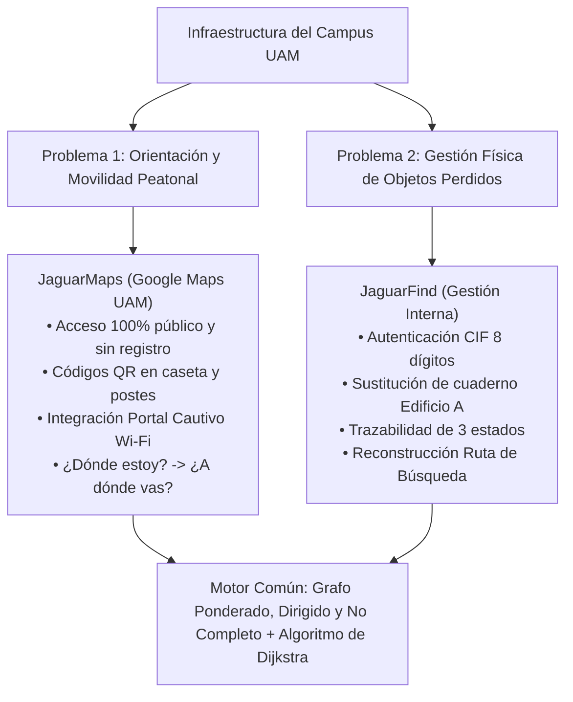
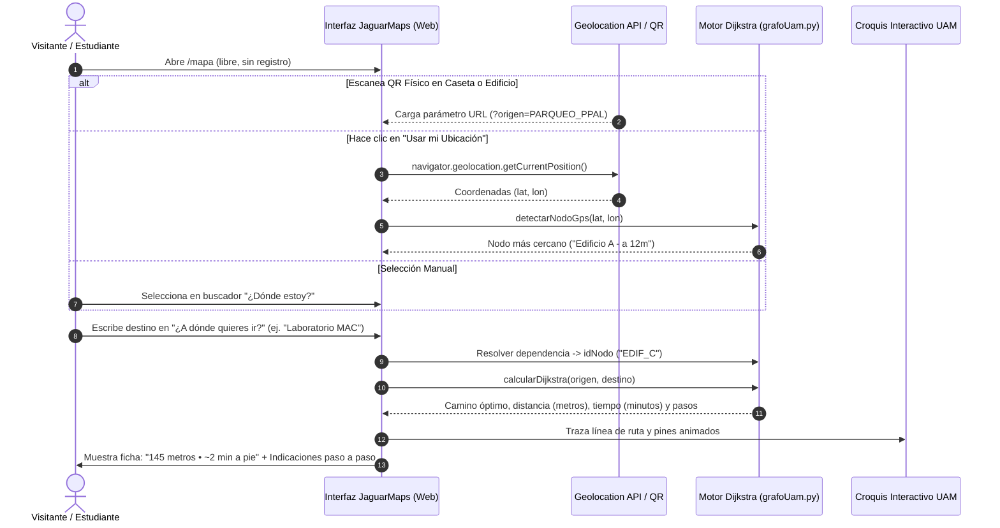
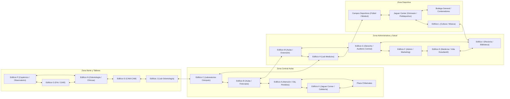
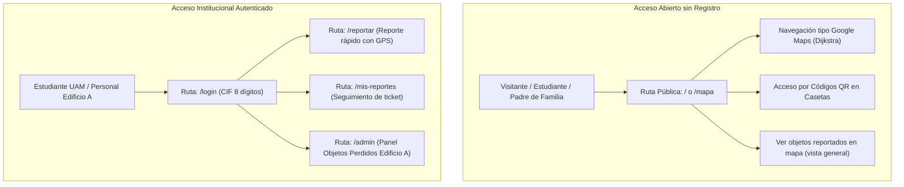
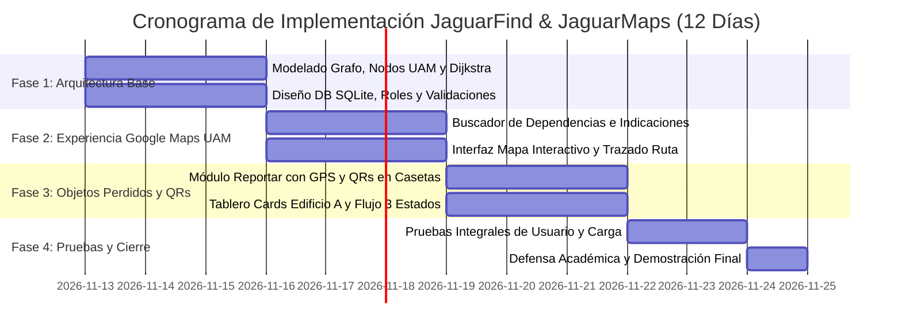

# JaguarFind & JaguarMaps: Especificación Técnica y Funcional Definitiva
**Sistema Web de Orientación Peatonal en el Campus (Google Maps UAM) y Gestión Inteligente de Objetos Perdidos mediante Grafos Ponderados, Dirigidos y No Completos**  
*Universidad Americana (UAM) — Programación Estructurada y Algoritmos / Estructuras de Datos*

---

## Ficha Resumen del Proyecto

| Parámetro | Detalle Institucional |
| :--- | :--- |
| **Nombre del Sistema** | **JaguarFind & JaguarMaps** |
| **Institución** | Universidad Americana (UAM), Managua, Nicaragua |
| **Asignatura** | Programación Estructurada y Algoritmos / Estructuras de Datos |
| **Integrantes del Equipo** | 1. **Br. Camila Javiera Navarro Centeno**<br>2. **Br. Francis Alejandra Solórzano Morales**<br>3. **Br. James Santiago Fernandez Obregon**<br>4. **Br. Elias Abraham Solis Guevara** |
| **Estructura de Datos Principal** | **Grafo Ponderado, Dirigido y No Completo** con implementación ad-hoc de **Algoritmo de Dijkstra** y cola de prioridad |
| **Stack Tecnológico** | **Backend:** Python 3 + Flask (Jinja2)<br>**Base de Datos:** SQLite3 (motor relacional embebido)<br>**Frontend:** HTML5 semántico + Tailwind CSS (Play CDN) + Geolocation API del navegador |
| **Módulos Principales** | 1. **JaguarMaps (Público, Abierto y Sin Registro):** Navegador peatonal "¿Dónde estoy? $\to$ ¿A dónde vas?" con Dijkstra, Códigos QR y Wi-Fi.<br>2. **JaguarFind (Interno y Autenticado con CIF):** Gestión integral y trazable de objetos perdidos en Edificio A. |

---

## 1. Planteamiento de los Dos Problemas Centrales del Campus UAM

A diferencia de un sistema administrativo convencional, el proyecto resuelve **dos problemáticas reales y complementarias** que conviven en el campus de la UAM, apalancándose en una misma estructura matemática de grafos:



### 1.1. Problema 1: Desorientación en el Campus y Limitación de la Señalética Física
* **La realidad actual:** El campus de la UAM cuenta con 16 edificios principales (A al P), complejos deportivos (Jaguar Center, Estadio de Béisbol, Canchas de Fútbol) y áreas comerciales distribuidas en varias hectáreas. Cada ciclo académico, cientos de estudiantes de nuevo ingreso, visitantes, padres de familia y docentes foráneos se pierden buscando aulas, clínicas odontológicas, laboratorios de ingeniería o dependencias administrativas.
* **La falla de los mapas estáticos:** Aunque en la universidad existen aproximadamente 3 tótems físicos con mapas (como el de la entrada principal), la inmensa mayoría de visitantes:
  1. No los ven o no saben dónde están ubicados físicamente.
  2. Son estáticos y no les indican cómo llegar a un punto específico desde donde están parados ni el tiempo de caminata.
  3. No permiten buscar por servicios o dependencias internas (ej. "¿Dónde queda la Caja/Tesorería?", "¿Dónde está el Laboratorio MAC?", "¿Dónde está el Observatorio Copérnico?").
* **Estrategia de Solución de JaguarMaps:**
  - **Acceso Inmediato Sin Registro:** No se exige cuenta ni inicio de sesión a los visitantes. El mapa digital se abre al instante en el navegador de cualquier teléfono o computadora.
  - **Puntos de Contacto Físicos mediante Códigos QR:** Se diseñan códigos QR contextuales para ser colocados en la Caseta de Entrada Principal, paradas de autobús, postes y accesos a edificios. Al escanear el QR, la URL contiene el parámetro de ubicación (ej. `https://jaguarfind.uam.edu.ni/mapa?origen=PARQUEO_PPAL`), abriendo el mapa con el pin "Usted está aquí" ya fijado.
  - **Página de Éxito / Portal Cautivo Wi-Fi UAM:** Al conectarse a las redes Wi-Fi institucionales (`UAM_Visitantes` o `UAM_Estudiantes`), se presenta la bienvenida con un acceso directo al mapa interactivo.

### 1.2. Problema 2: Gestión Manual e Ineficiente de Objetos Perdidos
* **La realidad actual:** La pérdida de pertenencias (botellas, carnés, calculadoras, laptops, suéteres) se gestiona mediante un cuaderno físico en la oficina de atención/recepción del **Edificio A**. Esto ocasiona que quien pierde un objeto deba peregrinar hasta el Edificio A a preguntar a ciegas, no existe trazabilidad de quién entregó el bien, y se carece de vinculación geográfica sobre dónde ocurrió el extravío.
* **Estrategia de Solución de JaguarFind:**
  - **Digitalización Interna y Segura:** Requiere inicio de sesión institucional con CIF de 8 dígitos y correo `@uamv.edu.ni` para evitar publicaciones falsas o bromas.
  - **Ciclo de Vida en 3 Estados:** Registro inicial del hallazgo $\to$ Custodia física verificada en Edificio A $\to$ Entrega auditada al dueño legítimo con validación de cédula y pregunta antifraude.
  - **Reconstrucción de Ruta de Búsqueda:** El estudiante ingresa los edificios que visitó durante el día y el algoritmo filtra automáticamente los objetos encontrados a lo largo de toda esa ruta de paso.

---

## 2. Experiencia "Google Maps UAM": ¿Dónde estoy? y ¿A dónde quieres ir?

El módulo interactivo de navegación peatonal emula la simplicidad de Google Maps, adaptado a la escala y arquitectura del campus universitario.



### 2.1. Selector "¿Dónde estoy?" (Origen)
Ofrece 3 métodos flexibles para garantizar que nadie quede sin ubicación:
1. **Detección Automática vía GPS:** Con un botón "Mi ubicación actual", el navegador captura las coordenadas y Python calcula el nodo más cercano mediante la fórmula de Haversine.
2. **Escaneo de Código QR Físico:** Cada tótem o caseta tiene un QR con URL parametrizada:
   - Caseta Entrada Sur: `/mapa?origen=PARQUEO_PPAL`
   - Edificio A (Recepción): `/mapa?origen=EDIF_A`
   - Edificio K (Cafetería): `/mapa?origen=EDIF_K`
   - Edificio P (Copérnico): `/mapa?origen=EDIF_P`
   - Edificio O (FIA / Ingeniería): `/mapa?origen=EDIF_O`
3. **Selector Manual / Clic en el Mapa:** Permite buscar o hacer clic directo sobre cualquier edificio del croquis.

### 2.2. Selector "¿A dónde quieres ir?" (Destino con Catálogo de Dependencias)
Los visitantes no siempre conocen el nombre de la letra del edificio; buscan por servicio, aula o facultad. El sistema incorpora un diccionario inteligente de resolución de dependencias:

| Lo que escribe el usuario en el buscador | Nodo al que resuelve | Nombre Oficial y Edificio |
| :--- | :--- | :--- |
| "Caja", "Tesorería", "Pagar colegiatura" | `EDIF_C` | Edificio C (Primer Piso) |
| "Laboratorios MAC", "Cómputo", "Erasmus+" | `EDIF_C` | Edificio C (Segundo Piso) |
| "Biblioteca", "Biblioteca Central", "Rectoría" | `EDIF_I` | Edificio I (Edificio de Rectoría) |
| "Observatorio", "Copérnico", "Meteorología" | `EDIF_P` | Edificio P (Quinto Piso) |
| "Cafetería", "Jaguar Corner", "Comida", "Almorzar" | `EDIF_K` | Edificio K (Área de Comidas y Kioscos) |
| "Objetos Perdidos", "Atención al Estudiante", "Admisiones", "CAE" | `EDIF_A` | Edificio A (Primer Piso) |
| "Language Center", "Derecho", "Auditorio Central" | `EDIF_G` | Edificio G (Facultad de Ciencias Jurídicas) |
| "Gimnasio", "Jaguar Gym", "Canchas Multiuso" | `JAGUAR_CTR` | Complejo Deportivo Jaguar Center |
| "Estadio", "Béisbol", "Cancha de Fútbol" | `ZONA_DEP` | Campos Deportivos UAM |
| "Ingeniería", "FIA", "Robótica", "CIAR" | `EDIF_O` | Edificio O (Facultad de Ingeniería) |
| "Clínicas Odontológicas", "Quirófano Dental" | `EDIF_N` | Edificio N (Clínicas Odontológicas) |
| "Medicina", "Simuladores Médicos", "Cardiología" | `EDIF_E` | Edificio E (Facultad de Ciencias Médicas) |
| "Vida Estudiantil", "Emprendimiento" | `EDIF_E` | Edificio E (Anexos Norte y Oeste) |
| "Plaza Chilamates", "Kioscos al aire libre" | `PLAZA_CHIL` | Plaza Chilamates (Oeste del campus) |

### 2.3. Indicaciones Paso a Paso Generadas por Dijkstra
Al calcular la ruta, el sistema genera la tarjeta de navegación:
* **Métricas Principales:** Distancia total en metros y tiempo estimado de marcha a una velocidad peatonal promedio de $1.2 \text{ m/s}$ ($72 \text{ m/min}$):
  $$\text{tiempoMinutos} = \left\lceil \frac{\text{distanciaMetros}}{72} \right\rceil$$
* **Guía Textual de Navegación (Paso a Paso):**
  - *Ejemplo de Entrada Principal a Edificio C (Laboratorios MAC):*
    1. **Inicio:** Comienza en el **Parqueo Principal (Entrada Sur)**.
    2. **Paso 1:** Camina 65 metros hacia el norte en dirección al **Edificio K (Cafetería / Jaguar Corner)**.
    3. **Paso 2:** Gira ligeramente al noreste y avanza 45 metros hacia el **Edificio A (Atención al Estudiante)**.
    4. **Paso 3:** Continúa 35 metros recto hacia el **Edificio B (Aulas)**.
    5. **Paso 4:** Cruza el pasillo central 30 metros hacia el **Edificio C**.
    6. **Llegada:** ¡Has llegado a **Edificio C (Laboratorios de Cómputo / Caja UAM)**! *(Total: 175 metros • ~2.5 minutos a pie)*.

---

## 3. Modelado Matemático y Computacional del Grafo UAM

El motor de todo el sistema es un **Grafo Ponderado, Dirigido y No Completo** $G = (V, E, W)$.



### 3.1. Propiedades Formales del Grafo
1. **Grafo Dirigido ($E \subseteq V \times V$):** Cada arista tiene dirección explícita $(u \to v)$. Dado que los pasillos y andenes peatonales de la UAM son transitables en ambos sentidos (salvo accesos restringidos o torniquetes), cada sendero transitable se modela como un **par simétrico de aristas dirigidas opuestas** $(u \to v)$ y $(v \to u)$ con idéntico peso. Esto satisface formalmente el requerimiento de grafo dirigido sin restringir la circulación real.
2. **Grafo Ponderado ($W: E \to \mathbb{R}^+$):** Cada arista almacena un peso no negativo $w > 0$ correspondiente a la distancia física real en **metros** entre los dos nodos.
3. **Grafo No Completo ($|E| \ll |V|(|V|-1)$):** La conectividad es dispersa. No hay atajos aéreos ni caminos directos entre extremos del campus sin atravesar nodos intermedios.

### 3.2. Justificación de la Selección de Dijkstra ante el Jurado

| Algoritmo | Complejidad Temporal | Soporte de Pesos ($w \ge 0$) | Decisión y Argumento Técnico para el Jurado |
| :--- | :--- | :--- | :--- |
| **Dijkstra con Min-Heap (Seleccionado)** | **$O((V + E) \log V)$** | **Sí (Exacto en metros)** | **Aceptado:** Garantiza la distancia física real mínima y reconstruye la secuencia exacta de nodos intermedios. |
| **BFS (Búsqueda en Amplitud)** | $O(V + E)$ | No (asume peso = 1) | **Descartado:** Minimiza el número de saltos de edificios, no los metros caminados. Podría elegir una ruta de 2 saltos pero 300 metros frente a una de 3 saltos y 90 metros. |
| **Bellman-Ford** | $O(V \cdot E)$ | Sí (admite pesos negativos) | **Descartado:** Ineficiente. Los pesos negativos no existen en distancias físicas peatonales. |
| **Floyd-Warshall** | $O(V^3)$ | Sí (todos los pares) | **Descartado:** Cúbico y costoso en memoria. Una consulta de navegación solo requiere la ruta entre el origen y destino actual del usuario. |

---

## 4. Topología Oficial de Nodos y Conexiones del Campus UAM

Levantada directamente del mapa oficial institucional (`UAM - Mapa (1).pdf`):

| idNodo | Nombre Oficial | Dependencias Clave (Directorio UAM) | Coordenadas Relativas (Mapa %) | Coordenadas GPS Aprox. |
| :--- | :--- | :--- | :--- | :--- |
| `EDIF_A` | **Edificio A (Atención y Objetos Perdidos)** | **Oficina Objetos Perdidos**, CAE, Registro Académico, Admisiones, Contabilidad, Cajeros | X: 28%, Y: 58% | 12.12450, -86.27120 |
| `EDIF_B` | **Edificio B (Aulas)** | Aulas B101-B109, B201-B210, Módulo Comercial 1, Fotocopias Jaguar Shop | X: 34%, Y: 58% | 12.12465, -86.27095 |
| `EDIF_C` | **Edificio C (Laboratorios de Cómputo)** | Labs Cómputo C201-C205, Labs MAC C107/C203, Lab Acai-Erasmus+, Auditorios C101/C109, Caja UAM | X: 34%, Y: 53% | 12.12495, -86.27090 |
| `EDIF_D` | **Edificio D (Odontología Digital)** | Laboratorio Digital CAM-CAM, Aula D102, Servicio al Cliente | X: 31%, Y: 44% | 12.12530, -86.27105 |
| `EDIF_E` | **Edificio E (Ciencias Médicas)** | Clínicas Médicas, Centro de Cardiología, Vida Estudiantil, Innovación y Emprendimiento | X: 41%, Y: 72% | 12.12430, -86.27030 |
| `EDIF_F` | **Edificio F (Admin y Marketing)** | Facultad de Ciencias Administrativas y Económicas, Marketing, Diseño, Posgrados | X: 44%, Y: 68% | 12.12445, -86.27015 |
| `EDIF_G` | **Edificio G (Derecho y Auditorio Central)** | Ciencias Jurídicas, Language Center, UAM College, Centro de Mediación, Auditorio Central | X: 44%, Y: 62% | 12.12470, -86.27010 |
| `EDIF_H` | **Edificio H (Laboratorios de Medicina)** | Laboratorios H101-H107 y H201-H207, Supervisión de Calidad | X: 46%, Y: 50% | 12.12505, -86.27005 |
| `EDIF_I` | **Edificio I (Rectoría y Biblioteca Central)** | **Biblioteca Central UAM**, Rectoría, Vicepresidencia, Dirección Académica, Secretaría General | X: 55%, Y: 76% | 12.12390, -86.26930 |
| `EDIF_J` | **Edificio J (Lab Odontología)** | Laboratorios de Odontología J101-J102 | X: 29%, Y: 44% | 12.12535, -86.27125 |
| `EDIF_K` | **Edificio K (Jaguar Corner / Cafetería)** | Cafetería Central, Jaguar Corner, Terrazas, Módulos 1-4, Kioscos 1-2, Área de Mesas | X: 29%, Y: 66% | 12.12415, -86.27125 |
| `EDIF_L` | **Edificio L (Cultura y Música)** | Salón de Cultura, Aula de Música, Sanitarios y Vestidores | X: 69%, Y: 72% | 12.12420, -86.26830 |
| `EDIF_M` | **Edificio M (Aulas y Posgrado)** | Auditorio M101-M102, Aulas M201-M304, Gestión Ambiental, Extensión Universitaria | X: 45%, Y: 55% | 12.12485, -86.27020 |
| `EDIF_N` | **Edificio N (Clínicas Odontológicas)** | Quirófanos 1-2, Clínicas Odontológicas A-E, Radiología 1-3, Tomografía, Esterilización | X: 33%, Y: 40% | 12.12560, -86.27100 |
| `EDIF_O` | **Edificio O (Ingeniería y FIA)** | Facultad de Ingeniería y Arquitectura, CIAR (Robótica e IA), Redes, Mecánica de Suelos | X: 43%, Y: 32% | 12.12600, -86.27040 |
| `EDIF_P` | **Edificio P (Copérnico / Observatorio)** | **Observatorio Astronómico**, Estación Meteorológica, Talleres de Arquitectura, Aulas P101-P401 | X: 33%, Y: 27% | 12.12640, -86.27110 |
| `ZONA_DEP`| **Campos Deportivos** | Estadio de Béisbol, Cancha de Fútbol Campo, Oficinas de Deportes, Kiosco Deportivo | X: 64%, Y: 45% | 12.12550, -86.26870 |
| `JAGUAR_CTR`| **Complejo Jaguar Center** | Polideportivo, Cancha Voleibol Arena, Gimnasio Jaguar Gym, Artes Marciales, Fisioterapia | X: 64%, Y: 72% | 12.12425, -86.26880 |
| `PLAZA_CHIL`| **Plaza Chilamates** | Plazoleta al aire libre, Módulos Comerciales 1-3, Área de descanso | X: 24%, Y: 48% | 12.12510, -86.27180 |
| `PARQUEO_PPAL`| **Parqueo Principal / Entrada Sur** | Portón de Acceso Principal (Caseta de Seguridad Sur), Estacionamiento Central | X: 35%, Y: 85% | 12.12350, -86.27080 |

---

## 5. Arquitectura del Sistema y Diferenciación de Permisos



### 5.1. Esquema de Base de Datos SQLite3 (`database.py`) en camelCase
```sql
CREATE TABLE IF NOT EXISTS usuarios (
    cif TEXT PRIMARY KEY,
    nombreCompleto TEXT NOT NULL,
    correoInstitucional TEXT UNIQUE NOT NULL,
    carrera TEXT NOT NULL,
    cedula TEXT NOT NULL,
    passwordHash TEXT NOT NULL,
    rolUsuario TEXT NOT NULL CHECK(rolUsuario IN ('estudiante', 'admin')),
    fechaRegistro TEXT NOT NULL
);

CREATE TABLE IF NOT EXISTS objetosPerdidos (
    idTicket INTEGER PRIMARY KEY AUTOINCREMENT,
    categoria TEXT NOT NULL,
    color TEXT NOT NULL,
    descripcion TEXT NOT NULL,
    detalleOcultoValidador TEXT,
    idNodoHallazgo TEXT NOT NULL,
    fechaHoraHallazgo TEXT NOT NULL,
    estadoTicket INTEGER NOT NULL CHECK(estadoTicket IN (1, 2, 3)),
    cifEncontro TEXT NOT NULL,
    cedulaEncontro TEXT,
    cifDueno TEXT,
    nombreDueno TEXT,
    carreraDueno TEXT,
    cedulaDueno TEXT,
    fechaEntrega TEXT,
    FOREIGN KEY (cifEncontro) REFERENCES usuarios(cif)
);
```

### 5.2. Ciclo de Vida del Objeto y Regla Antifraude
1. **Estado 1: Reportado (En camino al Edificio A):** El estudiante que encuentra el objeto lo registra en `/reportar`. La fecha y hora se toman con `datetime.now()`, el nodo se sugiere vía GPS y sus datos institucionales quedan asociados.
2. **Estado 2: En Custodia (Verificado en Edificio A):** El estudiante entrega el artículo físico en Objetos Perdidos (Edificio A). El administrador busca el ticket, valida el estado físico y asienta la recepción.
3. **Estado 3: Entregado a su Dueño (Archivado):** El dueño se presenta en el Edificio A. El administrador le solicita describir el `detalleOcultoValidador` (ej. protector de pantalla específico, grabado en el termo, calcomanías interiores). Al verificar identidad con cédula y carné, se archiva la entrega.

---

## 6. Especificación del Código del Motor de Grafos (`grafoUam.py`)

```python
import heapq
import math

DICCIONARIO_DEPENDENCIAS = {
    # Edificio A
    "atencion": "EDIF_A", "cae": "EDIF_A", "admisiones": "EDIF_A", "cajeros": "EDIF_A",
    "objetos perdidos": "EDIF_A", "registro academico": "EDIF_A", "contabilidad": "EDIF_A",
    # Edificio B
    "aulas b": "EDIF_B", "fotocopias": "EDIF_B", "jaguar shop": "EDIF_B",
    # Edificio C
    "laboratorios mac": "EDIF_C", "computo": "EDIF_C", "erasmus": "EDIF_C",
    "caja": "EDIF_C", "tesoreria": "EDIF_C", "aulas c": "EDIF_C", "auditorio c101": "EDIF_C",
    # Edificio D
    "odontologia digital": "EDIF_D", "cam-cam": "EDIF_D", "servicio al cliente": "EDIF_D",
    # Edificio E
    "medicina": "EDIF_E", "cardiologia": "EDIF_E", "vida estudiantil": "EDIF_E", "emprendimiento": "EDIF_E",
    # Edificio F
    "marketing": "EDIF_F", "ciencias administrativas": "EDIF_F", "posgrados": "EDIF_F",
    # Edificio G
    "derecho": "EDIF_G", "relaciones internacionales": "EDIF_G", "language center": "EDIF_G",
    "uam college": "EDIF_G", "auditorio central": "EDIF_G",
    # Edificio H
    "laboratorios medicina": "EDIF_H",
    # Edificio I
    "biblioteca": "EDIF_I", "biblioteca central": "EDIF_I", "rectoria": "EDIF_I", "direccion academica": "EDIF_I",
    # Edificio K
    "cafeteria": "EDIF_K", "jaguar corner": "EDIF_K", "comida": "EDIF_K", "almuerzo": "EDIF_K", "kioscos": "EDIF_K",
    # Edificio L
    "cultura": "EDIF_L", "musica": "EDIF_L",
    # Edificio M
    "auditorio m": "EDIF_M", "aulas m": "EDIF_M", "gestion ambiental": "EDIF_M",
    # Edificio N
    "clinicas odontologicas": "EDIF_N", "quirofano dental": "EDIF_N", "radiologia": "EDIF_N",
    # Edificio O
    "ingenieria": "EDIF_O", "fia": "EDIF_O", "robotica": "EDIF_O", "ciar": "EDIF_O",
    # Edificio P
    "observatorio": "EDIF_P", "copernico": "EDIF_P", "meteorologia": "EDIF_P", "arquitectura": "EDIF_P",
    # Deportes
    "estadio": "ZONA_DEP", "beisbol": "ZONA_DEP", "futbol": "ZONA_DEP", "cancha futbol": "ZONA_DEP",
    "gimnasio": "JAGUAR_CTR", "jaguar gym": "JAGUAR_CTR", "voleibol": "JAGUAR_CTR", "polideportivo": "JAGUAR_CTR",
    # Otros
    "chilamates": "PLAZA_CHIL", "plaza chilamates": "PLAZA_CHIL",
    "entrada": "PARQUEO_PPAL", "caseta": "PARQUEO_PPAL", "parqueo": "PARQUEO_PPAL"
}

class Arista:
    def __init__(self, destino, pesoMetros):
        self.destino = destino
        self.pesoMetros = pesoMetros

class Nodo:
    def __init__(self, idNodo, nombre, xPorcentaje, yPorcentaje, latitud, longitud):
        self.idNodo = idNodo
        self.nombre = nombre
        self.xPorcentaje = xPorcentaje
        self.yPorcentaje = yPorcentaje
        self.latitud = latitud
        self.longitud = longitud
        self.aristasAdyacentes = []

class GrafoUam:
    def __init__(self):
        self.nodos = {}

    def agregarNodo(self, idNodo, nombre, x, y, lat, lon):
        if idNodo not in self.nodos:
            self.nodos[idNodo] = Nodo(idNodo, nombre, x, y, lat, lon)

    def agregarAristaDirigida(self, origen, destino, pesoMetros):
        if origen in self.nodos and destino in self.nodos:
            self.nodos[origen].aristasAdyacentes.append(Arista(destino, pesoMetros))

    def agregarAristaBidireccional(self, nodoA, nodoB, pesoMetros):
        self.agregarAristaDirigida(nodoA, nodoB, pesoMetros)
        self.agregarAristaDirigida(nodoB, nodoA, pesoMetros)

    def resolverDestino(self, textoBusqueda):
        """Resuelve texto libre a un idNodo oficial del grafo."""
        texto = textoBusqueda.strip().lower()
        if texto.upper() in self.nodos:
            return texto.upper()
        for clave, idNodo in DICCIONARIO_DEPENDENCIAS.items():
            if clave in texto:
                return idNodo
        return None

    def calcularDijkstra(self, origenId, destinoId):
        """Calcula el camino mínimo con cola de prioridad heapq O((V+E) log V)."""
        if origenId not in self.nodos or destinoId not in self.nodos:
            return [], float('inf'), []

        distancias = {n: float('inf') for n in self.nodos}
        anteriores = {n: None for n in self.nodos}
        distancias[origenId] = 0
        cola = [(0, origenId)]

        while cola:
            distActual, u = heapq.heappop(cola)
            if distActual > distancias[u]:
                continue
            if u == destinoId:
                break
            for arista in self.nodos[u].aristasAdyacentes:
                v = arista.destino
                nueva = distActual + arista.pesoMetros
                if nueva < distancias[v]:
                    distancias[v] = nueva
                    anteriores[v] = u
                    heapq.heappush(cola, (nueva, v))

        camino = []
        actual = destinoId
        while actual is not None:
            camino.insert(0, actual)
            actual = anteriores[actual]

        if not camino or camino[0] != origenId:
            return [], float('inf'), []

        # Generar indicaciones paso a paso
        indicaciones = self.generarIndicacionesPasoAPaso(camino)
        return camino, distancias[destinoId], indicaciones

    def generarIndicacionesPasoAPaso(self, camino):
        indicaciones = []
        if not camino or len(camino) < 2:
            return ["Ya estás en tu destino."]
        
        indicaciones.append(f"Inicia tu recorrido en {self.nodos[camino[0]].nombre}.")
        for i in range(len(camino) - 1):
            u, v = camino[i], camino[i+1]
            dist = next((a.pesoMetros for a in self.nodos[u].aristasAdyacentes if a.destino == v), 0)
            indicaciones.append(f"Camina {dist}m hacia {self.nodos[v].nombre}.")
        indicaciones.append(f"Has llegado a tu destino: {self.nodos[camino[-1]].nombre}.")
        return indicaciones

    def detectarNodoGps(self, latUsuario, lonUsuario):
        """Encuentra el nodo más cercano usando la fórmula de Haversine."""
        nodoCercano = None
        minDist = float('inf')
        R = 6371000
        for idNodo, nodo in self.nodos.items():
            dLat = math.radians(nodo.latitud - latUsuario)
            dLon = math.radians(nodo.longitud - lonUsuario)
            a = math.sin(dLat/2)**2 + math.cos(math.radians(latUsuario)) * math.cos(math.radians(nodo.latitud)) * math.sin(dLon/2)**2
            c = 2 * math.atan2(math.sqrt(a), math.sqrt(1-a))
            dist = R * c
            if dist < minDist:
                minDist = dist
                nodoCercano = idNodo
        return nodoCercano, round(minDist, 1)
```

---

## 7. Plan de Trabajo y Asignación de Roles (10 a 12 Días)

| Integrante / Rol | Especialidad | Responsabilidades y Entregables Clave |
| :--- | :--- | :--- |
| **Rol 1: Especialista en Estructuras de Datos**<br>*(Br. Camila Javiera Navarro)* | **Motor de Grafos y Algoritmos (`grafoUam.py`)** | • Implementar `Nodo`, `Arista` y `GrafoUam` en POO estructurada.<br>• Mapear los 20 nodos y conexiones reales del campus.<br>• Programar `calcularDijkstra()`, `generarIndicacionesPasoAPaso()`, `detectarNodoGps()` y `resolverDestino()`.<br>• Pruebas unitarias de caminos mínimos y rutas complejas. |
| **Rol 2: Desarrollador Backend y Datos**<br>*(Br. Francis Alejandra Solórzano)* | **Persistencia y Controladores (`database.py` y `app.py`)** | • Configurar base de datos SQLite3 con esquema en camelCase.<br>• Programar endpoints `/api/ruta`, `/reportar` y `/login`.<br>• Validaciones regex: CIF (8 dígitos), clave (6 alfanuméricos), correo institucional `@uamv.edu.ni`.<br>• Manejo de parámetros de URL para códigos QR (`?origen=...`) y sesiones Flask. |
| **Rol 3: Desarrollador Frontend y Mapa**<br>*(Br. James Santiago Fernandez)* | **Vistas de Estudiante y Mapa (`index.html`, `reportar.html`)** | • Maquetar la experiencia tipo Google Maps con Tailwind CSS.<br>• Selector "¿Dónde estoy?" (GPS / QR / manual) y "¿A dónde quieres ir?".<br>• Trazado dinámico de la ruta sobre el mapa `mapaUam.png` con SVG/canvas.<br>• Despliegue de ficha de resultados (distancia, minutos a pie y pasos). |
| **Rol 4: Desarrollador Panel Admin e Integración**<br>*(Br. Elias Abraham Solis)* | **Módulo Edificio A y Despliegue (`admin.html`, `login.html`)** | • Construir tablero Kanban/Cards para Objetos Perdidos en Edificio A.<br>• Buscador rápido de tickets por CIF o nombre de estudiante.<br>• Modales de transición de estado con validación de `detalleOcultoValidador`.<br>• Generador de Códigos QR para imprimir en caseta y edificios. |

---

## 8. Cronograma de Desarrollo Día a Día



---

## 9. Criterios de Evaluación y Argumentos de Defensa ante el Jurado

1. **Doble Propósito con una Única Estructura de Datos:** Destacar que no se inventaron estructuras innecesarias; el mismo grafo modela el campus tanto para guiar a un visitante que no conoce la UAM como para rastrear pertenencias extraviadas.
2. **Impacto Práctico Inmediato:** El uso de Códigos QR en la caseta de entrada principal y en los edificios resuelve el problema de los mapas físicos estáticos que nadie ve o entiende.
3. **Justificación Algorítmica Impecable:** Demostrar por qué Dijkstra con Min-Heap ($O((V+E)\log V)$) es matemáticamente superior a BFS y Floyd-Warshall en el contexto físico de un campus universitario.
4. **Seguridad y Privacidad:** Explicar cómo la separación entre el mapa público (sin registro) y la gestión de objetos perdidos (con CIF y validación antifraude) protege la información de la comunidad universitaria.
