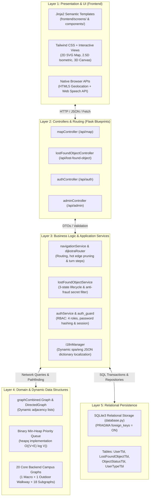
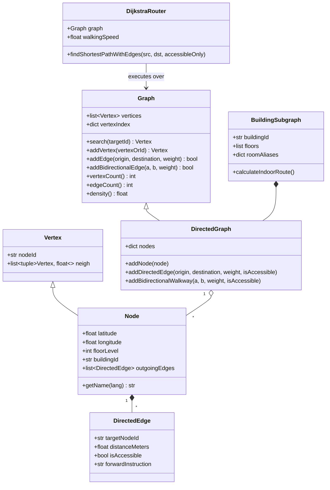
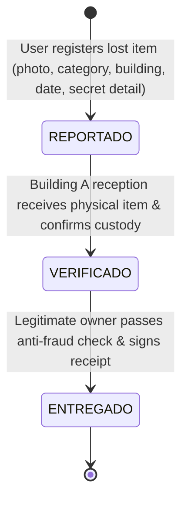

# JaguarFind & JaguarMaps
**Pedestrian Campus Navigation (Google Maps UAM) & Traceable Lost-and-Found Management System**  
*Universidad Americana (UAM), Managua, Nicaragua*  
*Course: Structured Programming and Algorithms / Data Structures*  
*Authors: Camila Javiera Navarro Centeno & Francis Alejandra Solórzano Morales*  
*Live Production Deployment (Azure):* <https://jaguar-find-app-service.azurewebsites.net/>  
*Repository (GitHub):* <https://github.com/camijavi/python_flask_jaguar_find>  

---

## Project Overview & Core Problems

JaguarFind & JaguarMaps is a dual-module web application engineered in Python and Flask, deployed to Microsoft Azure, and backed by dynamic data structures built from scratch. The system simultaneously addresses two critical everyday friction points on the Universidad Americana (UAM) campus using a shared mathematical graph foundation:

1. **Problem 1 — Campus Disorientation & Physical Signage Limitations (JaguarMaps):**  
   UAM spans 16 main buildings (Buildings A through P), specialized dental/medical clinics, sports complexes, and commercial areas. Fixed physical maps are sparse (concentrated almost exclusively near Buildings A and B), static, and do not provide customized pedestrian routing, accessibility filters, or indoor room-level guidance. JaguarMaps provides instant, open web navigation with turn-by-turn routing, wheelchair accessibility, and voice assistance.
2. **Problem 2 — Manual, Inefficient Lost-and-Found Management (JaguarFind):**  
   Property extraviation was historically tracked in a paper notebook at the Building A reception desk. This generated unnecessary walking trips, zero remote traceability, no fraud filters, and no spatial correlation. JaguarFind digitizes the full custody lifecycle into an auditable 3-state machine with an anti-fraud validation mechanism and campus map pin projection.

---

## Main Features

### JaguarMaps: Campus Navigation & Mobility
* **Public & Open Access:** Zero barrier to entry — visitors and students navigate immediately at `/mapa` without requiring login or registration.
* **Smart Dependency Search:** Resolves natural queries (e.g., *"Cashier"*, *"Dental Clinics"*, *"MAC Lab"*, *"Copernicus Observatory"*) to exact campus graph nodes.
* **Dual Location Selectors:** Select origins and destinations manually or via browser GPS matching using the Haversine formula against field-calibrated coordinates.
* **Universal Accessibility Filter:** Dynamic pruning switch that instantly eliminates edges containing stairs or steps, generating wheelchair-friendly, barrier-free routes for mobility-impaired visitors and clinic patients.
* **Multi-Dimensional Visual Views:**
  * **2D Vector Map:** Interactive SVG campus layout with animated route polylines.
  * **2.5D Isometric Perspective:** Oblique isometric view rendered via CSS 3D transforms.
  * **3D Building Visualizer:** Exploratory 3D canvas (e.g., Building P & Copernicus Observatory).
* **Bilingual Turn-by-Turn Voice Guidance:** Complete step instructions in English and Spanish via JSON translation catalogs (`spa.json` / `eng.json`) and spoken locally using the browser's native Web Speech API.

### JaguarFind: Digital Custody & Lost-and-Found
* **Institutional Authentication:** Secured role-based access for students (8-digit CIF), collaborators, administrators, and visitors.
* **Auditable 3-State Lifecycle:** Every item transitions through `REPORTED` $\to$ `VERIFICADO` $\to$ `ENTREGADO`.
* **Golden Anti-Fraud Rule (Secret Validation Detail):** Item submitters record a private identifying detail (e.g., *"cat sticker on the bottom"*). This secret attribute is strictly hidden from public APIs and catalogs, only viewable by Building A administrators during counter verification.
* **Spatial-Temporal Correlation by Location & Date:** Matches lost items by campus building/room and calendar date rather than exact timestamp, avoiding false negatives caused by the natural lag between losing an object and finding it.
* **Interactive Map Pin Projection:** Verified lost objects are projected directly onto the campus navigation map as interactive location markers.

### QR Codes for Official University Adoption
* **Status: Planned Architectural Requirement.** The current release does not parse QR link parameters or generate physical signage. If UAM officially adopts JaguarFind, physical QR placards will be installed at campus gates and building entrances (e.g., `/mapa?origen=PARQUEO_PPAL`), opening the public navigation map with a pre-validated origin point.

---

## System & Code Architecture (Layered MVC)

The application adheres to a decoupled **Layered Model-View-Controller (MVC)** architecture complemented by a dedicated **Application Service Layer** and an independent **Graph Routing Engine**:



### Modular Directory Structure
```text
app.py                         Production WSGI entry point (Gunicorn / Development)
backend/
  app.py                       Application Factory (createApp), Jinja2 loaders, i18n
  config.py                    Environment variables & database configuration
  auth_guard.py                Route decorators (@login_required, @admin_required)
  database.py                  SQLite3 schema DDL, repository layer & seeds
  i18n.py                      Bilingual translation engine (singleton pattern)
  api/                         API blueprint definitions
  controllers/                 Modular Flask controllers (Map, Lost&Found, Auth, Admin)
  services/                    Business logic services (Navigation, Custody, Auth)
  graph/                       Core mathematical graph engine & Dijkstra router
    graphCombined.py           Base Vertex & Graph classes
    directedGraph.py           Domain Node, DirectedEdge & DirectedGraph classes
    dijkstraRouter.py          Dijkstra algorithm with min-heap priority queue
    campusGraphBuilder.py      Tier 1 Macro Campus Graph constructor
    pedestrianWalkwayGraph.py  Tier 2 Detailed Outdoor Walkway Graph
    navigationService.py       Inter-graph resolver & path aggregator
    geoUtils.py & gpsMatcher.py Haversine formula & reverse GPS matching
  subgraphs/                   Tier 3 Indoor building subgraphs (A through P, Sports)
  languages/                   Translation catalogs (spa.json, eng.json)
frontend/
  screens/                     Full Jinja2 web screens (map, catalog, auth, admin)
  components/                  Reusable UI components (navbar, modals, object cards)
  static/                      Custom CSS, client-side JS (campusWalkwaysLayer.js), images
tests/                         Automated unit test suite (routing, pruning, GPS, RBAC)
docs/                          Technical diagrams and architecture specifications
startup.sh                     Azure App Service Linux startup script
requirements.txt               Python dependencies
```

---

## Dynamic Data Structures & Mathematical Model

The routing core is built entirely from scratch in native Python without third-party graph libraries (such as NetworkX).

### Formal Mathematical Model: $G = (V, E, W)$
Every graph in the system fulfills three strict formal properties:
1. **Directed ($E \subseteq V \times V$):**  
   Edges are ordered pairs $(u \to v)$ storing explicit walking direction. This models real pedestrian asymmetries: climbing up stairs vs. descending, steep ramps, one-way turnstiles, or indoor fire exits. Two-way sidewalks are modeled as antiparallel symmetric edge pairs with distinct, localized forward/backward speech instructions.
2. **Weighted ($W: E \to \mathbb{R}^+$):**  
   Every edge carries a strictly positive weight $w(u, v) > 0$ representing physical walking distance in meters, calibrated from field GPS waypoints (`coordenadas.txt`) and SVG affine projection.
3. **Non-Complete ($|E| \ll |V|(|V|-1)$):**  
   The campus is a sparse topological network ($\rho = \frac{|E|}{|V|(|V|-1)} \ll 1.0$). Walkways follow physical sidewalks, doors, and corridors, respecting building perimeters and walls (*Gateway Pattern*).

### The 3 Hierarchical Graph Tiers (20 Backend Graphs)
All graphs inherit from `graphCombined.Graph` and are managed through `graphRegistry.py`:

| Layer / Role | Graph Count | Vertices $\|V\|$ | Directed Edges $\|E_{\text{dir}}\|$ | Base Class |
| :--- | :---: | :---: | :---: | :--- |
| **Tier 1 — Macro Campus Graph** (Gates, Buildings, Plazas) | **1** | 28 | 110 | `DirectedGraph` |
| **Tier 2 — Micro Outdoor Walkway Graph** (Sidewalks, Crosswalks, Skybridges) | **1** | 209 | 508 | `DirectedGraph` |
| **Tier 3 — Micro Indoor Building Subgraphs** (Floors 1–5, Rooms, Labs, Restrooms) | **18** | 261 | 538 | `BuildingSubgraph` |
| **Total Unified Core Backend Graphs** | **20** | **498** | **1,156** | **`graphCombined.Graph`** |

### Dynamic Data Structures in Memory & Complexity Analysis



* **Dynamic Adjacency Lists (`Vertex.neigh` & `Node.outgoingEdges`):**  
  * *Space Complexity:* $O(V + E)$. An adjacency matrix would consume $O(V^2) \approx 498^2 = 248,000$ entries, where over 99% would be wasted zeros. Adjacency lists optimize RAM allocation on cloud containers and accelerate neighborhood expansion to $O(\text{deg}(u))$.
* **Binary Min-Heap Priority Queue (`heapq`):**  
  * *Time Complexity:* $O((V + E) \log V)$. By using a binary min-heap to extract the minimum accumulated distance vertex in $O(\log V)$ rather than a naive linear array search $O(V)$, Dijkstra completes route calculations across the full campus in under 5 milliseconds.
* **Dynamic Hash Maps ($O(1)$ amortized access):**  
  * `shortestDistances: Dict[str, float]`: Dynamic lookup of cumulative shortest paths.
  * `previousNodes: Dict[str, Optional[str]]`: Predecessor map enabling linear $O(V)$ route reconstruction from target to source.
* **Hot Runtime Pruning (Accessibility Switch):**  
  * When a user toggles wheelchair mode, the edge iterator inside `dijkstraRouter.py` evaluates `if accessibleOnly and not edge.isAccessible: continue`. It skips steps and staircases on the fly **without cloning, mutating, or reallocating the base graph in memory**.

---

## Lost & Found Custody Architecture (JaguarFind)



1. **State Machine & Data Integrity:**
   * `REPORTADO (Reported):` Initial user submission. Not visible on the public map or public catalog.
   * `VERIFICADO (Verified in Custody):` Physical item safely deposited at Building A reception. Activated on public catalog and projected as an interactive pin on the campus map.
   * `ENTREGADO (Claimed & Delivered):` Final custody release to confirmed owner. Archived for audit trails.
2. **Anti-Fraud Secret Validation Detail:**
   * At submission time, the user enters a non-visible identifier (`validationSecretDetail`).
   * **API Isolation:** This attribute is excluded from public JSON endpoints and catalog templates. Only authenticated Building A administrators can view it on their private verification console. The claimant must orally describe this detail at the counter to prove ownership.
3. **Query Optimization by Location & Date:**
   * Queries filter on indexed columns `ubicacionHallazgo` and `DATE(fechaReporte)`. By omitting exact hours, the system prevents false negatives caused by human reporting delays.

---

## Security & Role-Based Access Control (RBAC)

The system protects administrative and user workflows through a 4-tier RBAC model configured in `database.py` and enforced via `auth_guard.py`:

| Role | Identifier | Credential Policy | System Capabilities |
| :--- | :--- | :--- | :--- |
| **Student** | Institutional CIF (8 digits) | `@uamv.edu.ni` email + password | Report lost items, view personal submissions, claim items. Supports dual degree programs. |
| **Collaborator** | Nicaraguan National ID (Cédula) | Institutional email + password | Faculty and administrative staff reporting and tracking. |
| **Administrator** | Building A admin email | Cryptographic password hash (`Werkzeug pbkdf2/scrypt`) | Full custody management: status promotion, secret detail review, user moderation, analytics. |
| **Visitor** | National ID / Passport | Passwordless account | External parents, clinic patients, and event guests. **Automated cleanup routine purges accounts inactive for >180 days**. |

* **Session Security:** Session cookies are signed server-side using cryptographic secret keys, with parameterized SQL statements preventing SQL injection attacks across all endpoints.

---

## Generative AI Integration & UI Engineering

Generative AI was utilized as a **software engineering accelerator** during the UI prototyping phase, strictly separating algorithmic implementation from interface design:

* **Accelerated UI Prototyping:** Generative AI assisted in scaffolding semantic HTML5 layouts, component structures, and Tailwind CSS responsive utility classes.
* **Component-Based Modularity:** Jinja2 templates are organized into modular, reusable components (navigation bars, routing sidebars, modal dialogs, object cards).
* **Strict Manual Algorithmic Rigor:** All graph data structures, traversal algorithms, SQL repositories, and accessibility filters were engineered and validated manually by the development team.
* **Zero-Latency Bilingual i18n:** Dynamic localization dictionaries (`backend/languages/spa.json` and `eng.json`) translate navigation cues, place names, and dialogs instantly in client memory.

---

## Cloud Deployment & Production Infrastructure

* **Cloud Platform:** Microsoft Azure App Service (Linux Web App).
* **Runtime:** Python 3.10+ (64-bit).
* **WSGI Production Server:** Gunicorn configured via `startup.sh`:
  ```bash
  gunicorn --bind 0.0.0.0:8000 --timeout 600 app:app
  ```
* **Continuous Integration & Deployment (CI/CD):** Automated deployment connected to GitHub repository `camijavi/python_flask_jaguar_find`.
* **Live Production URL:** [https://jaguar-find-app-service.azurewebsites.net/](https://jaguar-find-app-service.azurewebsites.net/)

---

## Defense Technical Q&A (Rubric Alignment)

* **Why a directed graph instead of an undirected graph?**  
  Pedestrian paths on a campus are inherently directional. Directed graphs accurately model height transitions (staircases up vs. down), ramps with steep inclinations, emergency exit doors that only open from the inside, and directional audio speech instructions.
* **Why Dijkstra and not A* or Floyd-Warshall?**  
  Floyd-Warshall requires $O(V^3)$, which is prohibitive and unneeded for single-query on-demand routes. A* requires an admissible spatial heuristic; however, in an enclosed campus where users must navigate around buildings and walls, straight-line euclidean heuristics frequently mislead exploration. Dijkstra with a binary min-heap ($O((V+E)\log V)$) computes optimal paths in under 5 ms without heuristic overhead.
* **Why aren't lost objects connected directly to each other in the graph?**  
  Lost items have no intrinsic physical topology between each other (a water bottle does not connect to an ID card). The graph models pedestrian infrastructure. Items are instead *projected onto the graph's physical nodes*, allowing interactive spatial exploration and location-based filtering.
* **How is accessibility pruning kept memory-efficient?**  
  Pruning occurs during Dijkstra's adjacency relaxation loop by inspecting `edge.isAccessible`. Inaccessible edges are simply bypassed in $O(1)$ time, eliminating the overhead of cloning, mutating, or rebuilding graph instances in memory.

---

## Verification & Automated Test Suite

To run the automated verification suite across graph routing, i18n preservation, accessibility pruning, and visitor validation:

```bash
# Run the campus graph verification suite (routes, accessibility, i18n)
PYTHONPATH=. python3 tests/testCampusGraph.py

# Run visitor validation and auth tests
PYTHONPATH=. python3 -m unittest tests/testVisitorValidation.py

# Run all test suites
PYTHONPATH=. python3 -m unittest discover tests
```

---

## Authors & Institution

* **Authors:**
  * Camila Javiera Navarro Centeno
  * Francis Alejandra Solórzano Morales
* **Institution:** Universidad Americana (UAM), Managua, Nicaragua
* **Faculty:** Facultad de Ingeniería y Arquitectura (FIA) / Ciencias y Sistemas
* **Course:** Programación Estructurada y Algoritmos / Estructuras de Datos
