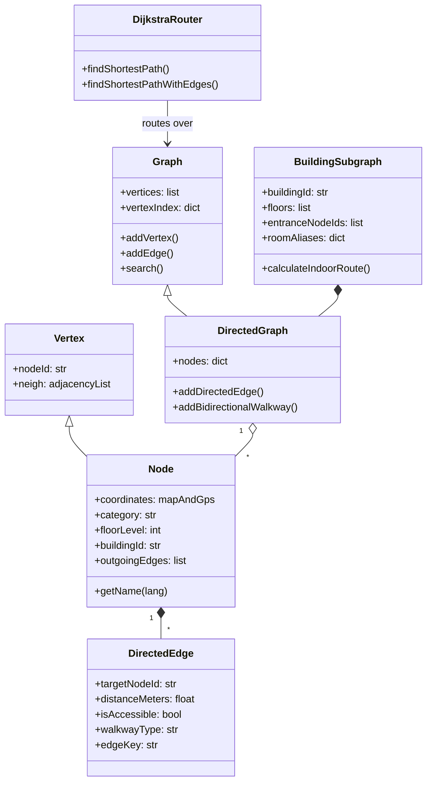
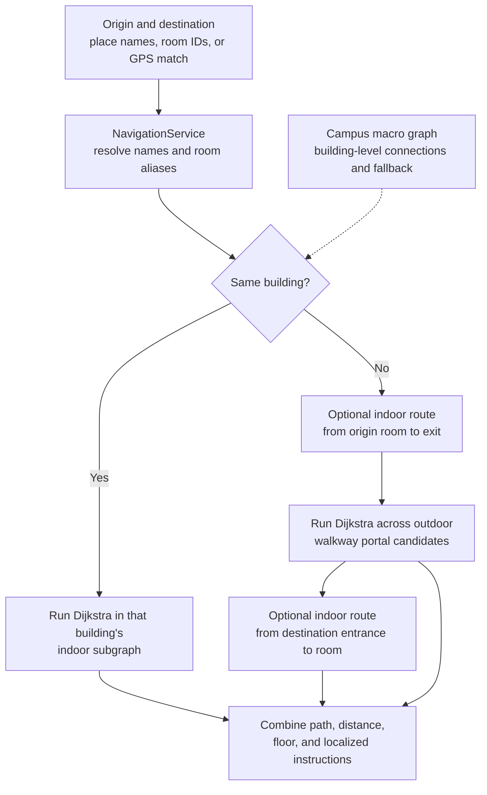
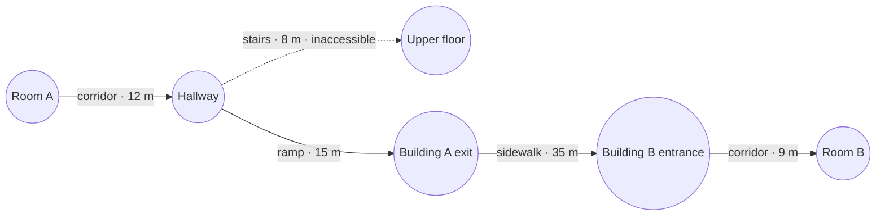
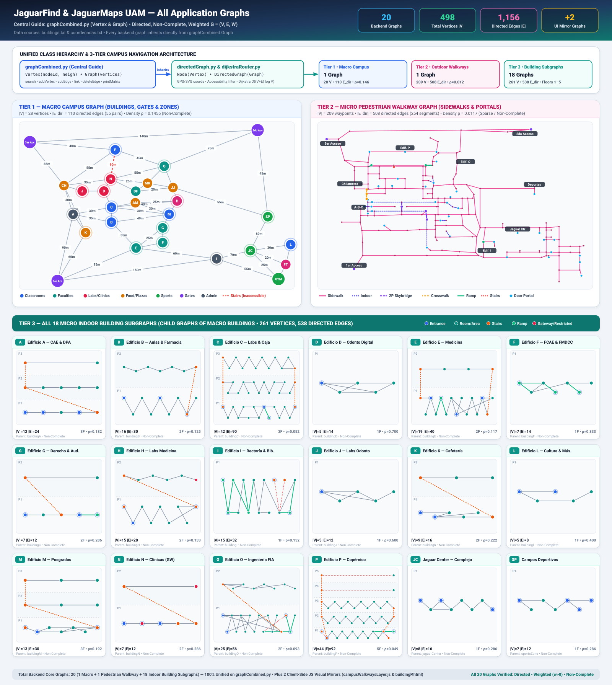

# JaguarFind & JaguarMaps

**JaguarFind & JaguarMaps** is a bilingual campus navigation and lost-and-found management system developed for Universidad Americana (UAM) in Managua, Nicaragua.

The project provides a pedestrian wayfinding system for students and visitors and a traceable custody system for lost objects found on campus.

## Project Context

UAM visitors and new students often need to find buildings, classrooms, clinics, laboratories, cafeterias, entrances, and administrative offices across a large campus. Physical signs and fixed maps do not always provide a route from the user's current location.

At the same time, lost objects at the university are traditionally recorded in a physical notebook at Building A. JaguarFind replaces that process with an authenticated digital workflow that records the item, physical custody, and final claim.

The system combines both needs into a shared campus graph:

- **JaguarMaps** lets users calculate pedestrian routes, use GPS or choose a campus location manually, and optionally exclude inaccessible walkways.
- **JaguarFind** lets authorized users report and manage lost objects while administrators control custody and claims.

## Main Features

### JaguarMaps campus navigation

- Public campus map, building directory, and place search for buildings, rooms, and facilities
- Responsive 2D map and 2.5D campus view
- Manual origin and destination selection, plus browser GPS location matching
- Campus and indoor building routes calculated with Dijkstra's algorithm
- Optional accessible routing that avoids stairs where accessible alternatives exist
- Turn-by-turn directions with English and Spanish Azure Speech audio
- English and Spanish interface and route instructions

### QR codes for official university adoption

**Status: planned, not implemented.** The current application does not read QR-code
location links or provide QR-code deployment support. If UAM adopts JaguarFind as
an official campus site, QR-code entry points should be implemented before that
launch. Scanning a campus QR code with a phone should open the public map and set
the correct, validated campus location as the origin. The university should also
approve the locations, destination URLs, and physical signage.

### JaguarFind lost-and-found

- Account registration and sign-in for students, collaborators, and visitors, with administrator access
- Lost-object reports with category, location, description, photo, and private identifying details
- Searchable catalog with category, custody-state, and building filters
- Three-state tracking: reported, in custody, and claimed
- Claim requests with private-detail verification for ownership review
- Map pins for active lost-and-found reports
- Administrator dashboard for custody, reports, and user management

## Graph Structure

JaguarMaps models walkable campus space as **weighted, directed, non-complete graphs**. A vertex is a location; an edge is a permitted walking transition; and its positive weight is the walking distance in meters.

\[
G = (V,E,W)
\]

### Graph data model

The shared base types in [`backend/graph/graphCombined.py`](backend/graph/graphCombined.py) provide `Vertex` and `Graph`. A vertex stores its ID and an adjacency list of `(neighbor, weight)` pairs; the graph stores its vertices and a case-insensitive ID index. `Graph.addEdge()` accepts only edges whose endpoints exist and rejects self-loops, non-positive weights, and duplicate directed edges.

The campus-specific types in [`backend/graph/directedGraph.py`](backend/graph/directedGraph.py) extend that base:

- `Node` adds location data such as GPS and map coordinates, category, floor, building, access level, and translated names.
- `DirectedEdge` adds routing metadata: accessibility, walkway type, landmark reference, and localized instruction key.
- `DirectedGraph` maintains both the base adjacency list and richer outgoing edge records, so routing can use weights while the UI and instruction builder can use edge metadata.
- A two-way corridor or walkway is represented by two separate directed edges, one in each direction, so each direction can carry its own instruction metadata.
- `BuildingSubgraph` wraps a `DirectedGraph` for one building, along with its floors, entrances, room aliases, and indoor router.



### Three graph layers

The graphs are organized by level of detail. The current counts below come from the live graph registry (`GET /api/map/graphs-summary`); the registry also checks that all graphs inherit from `Graph` and remain directed, positively weighted, and non-complete.

| Layer | Graphs | Vertices | Directed edges | Purpose |
|---|---:|---:|---:|---|
| Campus macro graph | 1 | 28 | 110 | Buildings, gates, plazas, and other campus destinations |
| Outdoor pedestrian graph | 1 | 209 | 508 | Detailed outdoor walkways, junctions, doors, ramps, stairs, and bridges |
| Indoor building subgraphs | 18 | 333 | 684 | Rooms, corridors, entrances, and floor-to-floor connections |
| **Total** | **20** | **570** | **1,302** | **The current backend graph inventory** |

`buildUamCampusGraph()` creates the campus-level graph in [`backend/graph/campusGraphBuilder.py`](backend/graph/campusGraphBuilder.py). The outdoor network is created in [`backend/graph/pedestrianWalkwayGraph.py`](backend/graph/pedestrianWalkwayGraph.py). Each indoor graph is defined under [`backend/subgraphs/`](backend/subgraphs/) and associated with its campus building. Portal mappings connect building-level locations to the detailed outdoor network.



### How routes are calculated

[`NavigationService`](backend/graph/navigationService.py) resolves a user's text to a campus node, place-catalog entry, outdoor waypoint, or indoor room/alias, then selects the appropriate graph or combination of graphs:

1. **Within one building:** run Dijkstra on that building's subgraph, which contains its rooms, corridors, stairs, ramps, and floor links.
2. **Between buildings:** when the origin is a room, first route to an appropriate building exit. Then evaluate candidate outdoor portals and route between them on the detailed walkway graph. When the destination is a room, finish with an indoor route from the selected entrance.
3. **Building-level fallback:** the campus macro graph supplies the high-level building network when a detailed walkway path is unavailable.
4. **Accessible mode:** the router skips outgoing edges whose `isAccessible` property is false. This excludes stairs or other marked segments while allowing accessible alternatives such as ramps.

[`DijkstraRouter`](backend/graph/dijkstraRouter.py) uses Python's `heapq` as a min-priority queue. It initializes the source distance to zero and other known vertices to infinity, repeatedly visits the closest queued vertex, relaxes its outgoing edges, and records each predecessor. Once the destination is reached, predecessor links are followed backward to reconstruct the path. The algorithm runs in \(O((V+E)\log V)\) time for these sparse graphs.

Each route result includes node IDs, total distance, estimated walking time, and step instructions. Edge instruction keys are translated for English or Spanish; missing edge-specific instructions fall back to a generic localized direction. The estimate uses the router's configured average walking speed of 72 meters per minute.

### Visual graph examples

This simplified diagram illustrates how a route can combine indoor and outdoor edges. Distances are illustrative; the application uses the weights configured for each real graph. In accessible mode, the stairs edge is excluded if it is marked inaccessible.



The following generated SVG shows the current campus macro graph, pedestrian walkway network, and indoor subgraphs. It is rendered from the live backend graphs by [`scripts/generateGraphDiagram.py`](scripts/generateGraphDiagram.py).



## Technology Stack

| Area | Technology |
|---|---|
| Backend and web framework | Python 3, Flask, Werkzeug |
| Templates | Jinja2 |
| Production server | Gunicorn |
| Database | SQLite (`sqlite3`) |
| Frontend | HTML5, custom CSS, and vanilla JavaScript |
| UI styling | Tailwind CSS CDN and custom CSS |
| Routing algorithm | Dijkstra's algorithm using Python's `heapq` |
| Geolocation | Browser Geolocation API, campus GPS matching, and Haversine calculations |
| Voice instructions | Azure AI Speech REST API, authenticated with Microsoft Entra ID |
| Internationalization | JSON translation dictionaries for English and Spanish |
| Azure integration | `azure-identity`, `requests`, and `python-dotenv` |
| Deployment | Azure App Service for Linux |

## Project Structure

```text
app.py                         Flask application entry point
backend/
  app.py                       Flask application factory
  api/                         REST API route modules
  controllers/                 Web and API controllers
  graph/                       Campus graph and Dijkstra engine
  subgraphs/                   Building and sports-complex subgraphs
  services/                    Business and navigation services
  database.py                  SQLite schema and repositories
  config.py                    Environment-based configuration
frontend/
  screens/                     Jinja2 application screens
  components/                  Reusable Jinja2 components
  static/                      CSS, JavaScript, and images
languages/                     English and Spanish translations
docs/                          Technical and functional documentation
jaguarFind.db                  Local-only SQLite database (ignored by Git)
startup.sh                     Azure App Service startup script
requirements.txt               Python dependencies
```

## Authors

- Camila Javiera Navarro Centeno
- Francis Alejandra Solórzano Morales

## Institution

Universidad Americana (UAM)  
Managua, Nicaragua

## Academic Context

Developed for the Structured Programming and Algorithms / Data Structures course.
