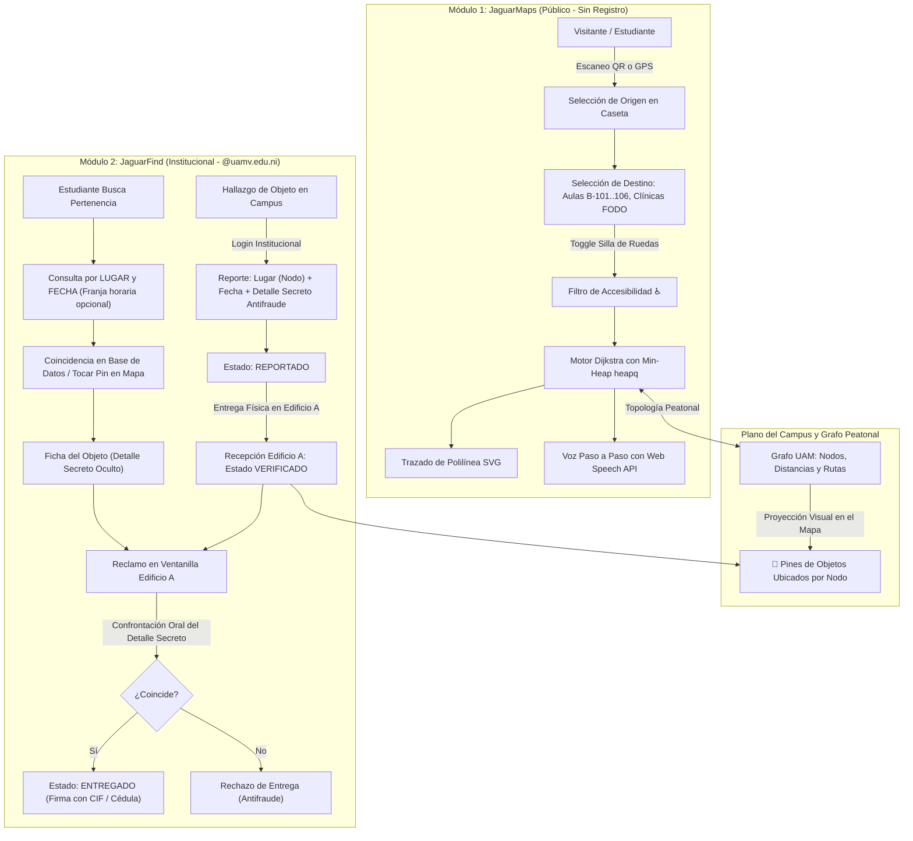
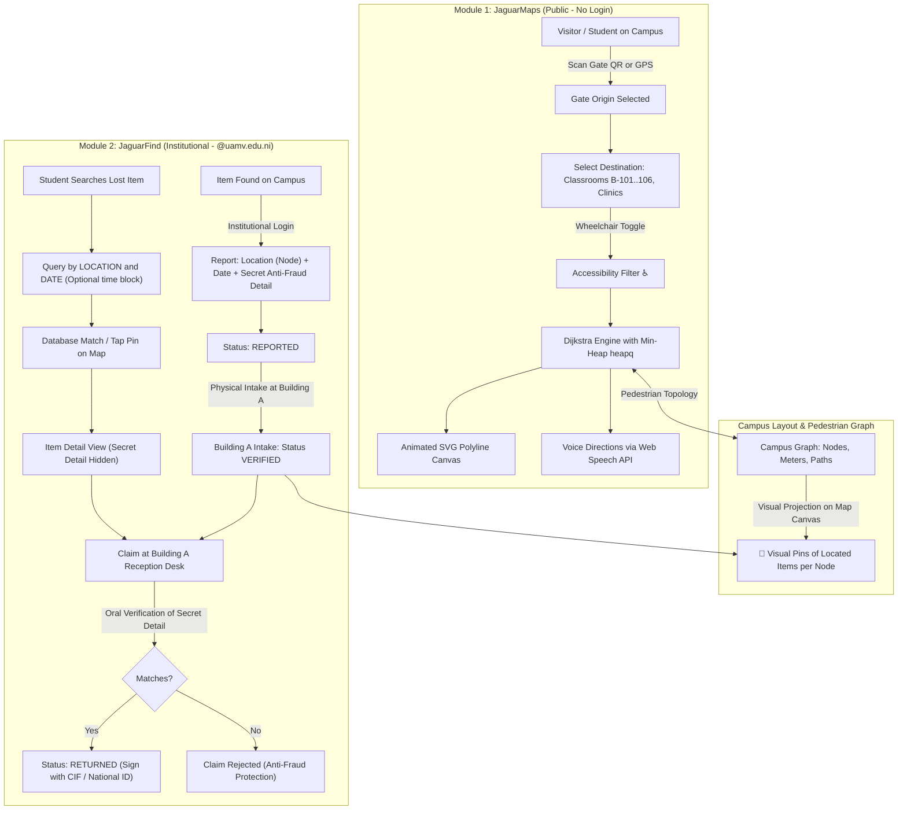

# JaguarFind: General Overview & System Architecture / Visión General y Arquitectura

---

<details open>
<summary><b>🇪🇸 Versión en Español (Haz clic para colapsar o expandir)</b></summary>

### 1. Ficha Resumen del Proyecto
* **Nombre de la Aplicación:** **JaguarFind**
* **Institución:** Universidad Americana (UAM), Managua, Nicaragua
* **Régimen Académico:** Semestral (Primer y Segundo Semestre, con intersemestrales)
* **Asignatura:** Programación Estructurada y Algoritmos / Estructuras de Datos
* **Integrantes del Equipo:**
  * Br. Camila Javiera Navarro Centeno (Estructuras de Datos y Algoritmos)
  * Br. Francis Alejandra Solórzano Morales (Backend y Persistencia)
  * Br. James Santiago Fernandez Obregon (Frontend y Experiencia de Usuario)
  * Br. Elias Abraham Solis Guevara (Panel Administrativo, Códigos QR e Integración)
* **Estructura de Datos Núcleo:** Grafo Ponderado, Dirigido y No Completo con Algoritmo de Dijkstra ($O((V+E)\log V)$)
* **Internacionalización (i18n):** Bilingüe Español e Inglés mediante diccionarios JSON en carpeta `languages/` (`spa.json` y `eng.json`)
* **Narración por Voz (TTS):** Web Speech API nativa del navegador en JavaScript (gratuita, sin latencia de servidor)
* **Stack Tecnológico:** Python 3 + Flask (Jinja2) + SQLite3 + Tailwind CSS (Play CDN) + HTML5 Geolocation API

---

### 2. Contexto Institucional y Dinámica del Campus UAM
La Universidad Americana (UAM) mantiene una vida universitaria muy activa con eventos académicos, deportivos y culturales. El flujo diario incluye:
1. **Padres de Familia y Visitantes:** Consultando información de admisiones para inscribir a sus hijos o pagando aranceles en Caja Central.
2. **Pacientes de Clínicas Universitarias:** Acudiendo a las Clínicas Odontológicas (FODO) en Edificios N, J y D, o Clínicas Médicas (FCM) en Edificio E.
3. **Gestiones en Facultades:** Estudiantes y docentes visitando decanatos de FIA (Ingeniería y Arquitectura), FODO (Odontología), FCJHRI (Ciencias Jurídicas), FCAE (Ciencias Administrativas) y FCM (Ciencias Médicas).

---

### 3. Planteamiento de los Dos Problemas Centrales
* **Problema 1: Orientación en el Campus (Módulo Mapa / JaguarMaps):**  
  Los mapas físicos de la UAM están concentrados casi exclusivamente cerca de los **Edificios A y B**. Quienes ingresan por los otros dos accesos (**Segundo Acceso Noreste** o **Tercer Acceso Norte Copérnico**) quedan muy lejos de la señalética. JaguarMaps ofrece navegación interactiva abierta (sin login), accesible mediante Códigos QR en las 3 entradas.
* **Problema 2: Cuaderno Físico de Objetos Perdidos (Módulo Objetos Perdidos):**  
  Sustituye el registro en papel del Edificio A por una plataforma institucional autenticada con 4 roles de usuario (Estudiante, Colaborador, Administrador y Visitante externo passwordless con purga a los 6 meses), ciclo de 3 estados y regla antifraude.

---

### 4. Estructura Matemática del Grafo y Relación de Objetos por Lugar y Fecha

#### A. Mecanismo del Grafo en el Sistema:
* **Grafo Topológico Peatonal $G_{\text{campus}} = (V, E, W)$ en `grafoUam.py`:**
  * $V$: Nodos geolocalizados que representan Casetas de Entrada con Códigos QR (`GATE_1`, `GATE_2`, `GATE_3`), aulas piso a piso (`B_101` a `B_106`), baños, clínicas FODO, admisiones y bifurcaciones de pasillos.
  * $E$: Aristas transitables con pesos $w(u,v) = \text{distancia en metros}$. Cada arista almacena la bandera booleana `esRutaAccesible`.
* **Uso 1 — Navegación Peatonal (Dijkstra con Min-Heap $O((V+E)\log V)$):**
  * Si se activa el modo de silla de ruedas ♿, se realiza una **poda algorítmica** de aristas con escalones o gradas.
  * Se extrae en tiempo logarítmico el camino de costo métrico mínimo, devolviendo el vector de coordenadas para la polilínea SVG animada y la lista de indicaciones secuenciales para la Web Speech API nativa.
* **Uso 2 — Proyección de Pines de Objetos Ubicados sobre el Grafo:**
  * El grafo **no se utiliza para relacionar objetos entre sí**. En su lugar, el grafo del mapa proyecta **pines o marcadores interactivos (📍)** sobre los nodos físicos donde fueron hallados o ubicados los objetos en custodia (ej. pin sobre `B_103` o `A_CAFETERIA`).
  * Los usuarios pueden explorar visualmente el mapa del campus y tocar los pines para ver los artículos encontrados en cada área.

#### B. ¿Cómo se Relacionan y Buscan los Objetos? (Lugar y Fecha):
* **Comparativa Técnica:**
  * **Opción [Lugar + Fecha + Hora]:** Deficiente debido a la *asincronía temporal inevitable* (la hora en que se extravía un objeto nunca coincide con la hora en que alguien lo encuentra; ej. perdido a las 9:00 AM y hallado por conserjería a la 1:30 PM). Exigir hora exacta genera falsos negativos masivos.
  * **Opción [Lugar + Fecha] (Seleccionada como la Mejor):** Óptima y realista. Los estudiantes recuerdan con certeza el día y el aula/edificio ("martes en B-103"). Permite agrupar todos los hallazgos de esa jornada en esa ubicación en una consulta relacional indexada limpia:
    ```sql
    SELECT * FROM objetosPerdidos 
    WHERE ubicacionHallazgo = ? AND DATE(fechaReporte) = ?
      AND estado IN ('REPORTADO', 'VERIFICADO');
    ```
  * Opcionalmente se puede filtrar por **Franja Horaria Flexible** (Mañana / Tarde / Noche) como ayuda orientativa secundaria, nunca como restricción al minuto.

---

### 5. Diagrama de Flujo Integral del Sistema



</details>

---

<details open>
<summary><b>🇺🇸 English Version (Click to collapse or expand)</b></summary>

### 1. Project Summary Sheet
* **Application Name:** **JaguarFind**
* **Institution:** Universidad Americana (UAM), Managua, Nicaragua
* **Academic Calendar:** Semester-based (First and Second Semester, with intersemester courses)
* **Course:** Structured Programming and Algorithms / Data Structures
* **Team Members:**
  * Br. Camila Javiera Navarro Centeno (Data Structures and Algorithms)
  * Br. Francis Alejandra Solórzano Morales (Backend and Persistence)
  * Br. James Santiago Fernandez Obregon (Frontend and User Experience)
  * Br. Elias Abraham Solis Guevara (Admin Panel, QR Codes, and Integration)
* **Core Data Structure:** Weighted, Directed, and Non-Complete Graph with Dijkstra's Algorithm ($O((V+E)\log V)$)
* **Internationalization (i18n):** Bilingual Spanish and English support via JSON dictionaries in `languages/` (`spa.json` and `eng.json`)
* **Voice Narration (TTS):** Browser-native Web Speech API in JavaScript (free, zero server latency)
* **Technology Stack:** Python 3 + Flask (Jinja2) + SQLite3 + Tailwind CSS (Play CDN) + HTML5 Geolocation API

---

### 2. Institutional Context and Campus Dynamics
Universidad Americana (UAM) sustains high daily activity with academic symposiums, athletic tournaments, and cultural events:
1. **Parents and Visitors:** Inquiring about admissions and enrollment or paying tuition at the Central Cashier.
2. **Clinical Patients:** Attending Dental Clinics (FODO) in Buildings N, J, and D, or Medical Clinics (FCM) in Building E.
3. **Faculty and Department Inquiries:** Students and faculty visiting dean offices in FIA (Engineering/Architecture), FODO (Dentistry), FCJHRI (Law), FCAE (Business), and FCM (Medicine).

---

### 3. The Two Core Problems Addressed
* **Problem 1: Wayfinding & Entrance Gate Distance (Campus Map Module):**  
  Physical map boards at UAM are clustered almost exclusively around **Buildings A and B**. Visitors entering via the other two gates (**Northeast Second Entrance** or **North Copernicus Third Entrance**) are stranded far away from signs. The map module provides open pedestrian guidance (no login required) via QR codes at all 3 gates.
* **Problem 2: Paper Notebook at Building A (Lost & Found Module):**  
  Replaces the handwritten paper logbook at Building A with an authenticated platform supporting 4 distinct user roles (Student, Collaborator, Administrator, and passwordless Visitor with 6-month inactivity retention), an auditable 3-state custody lifecycle, and anti-fraud validation.

---

### 4. Mathematical Graph Structure and Lost & Found Correlation by Location and Date

#### A. Graph Mechanism in the System:
* **Topological Campus Graph $G_{\text{campus}} = (V, E, W)$ in `grafoUam.py`:**
  * $V$: Nodes representing entrance gate QR codes (`GATE_1`, `GATE_2`, `GATE_3`), classroom entrances (`B_101` to `B_106`), restrooms, clinics, and corridor intersections.
  * $E$: Walkable corridors weighted by physical distance $w(u,v)$ in meters and an `esRutaAccesible` flag.
* **Role 1 — Pedestrian Navigation (Dijkstra with Min-Heap $O((V+E)\log V)$):**
  * When wheelchair accessibility ♿ is toggled, edges with steps/stairs are pruned out.
  * Yields the minimum-distance path coordinates for animated SVG polyline rendering and ordered textual steps consumed by the native Web Speech API.
* **Role 2 — Visual Projection of Located Item Pins on the Campus Graph:**
  * The graph is **not used to relate objects with one another**. Instead, the campus map graph projects **interactive pins (📍)** on the physical nodes where items have been located or held in custody (e.g. pin on `B_103` or `A_CAFETERIA`).
  * Users can explore the campus map visually and click on pins to view items found in that area.

#### B. How Items are Correlated & Searched (Location & Date):
* **Technical Evaluation:**
  * **Option [Location + Date + Time]:** Flawed due to *inevitable temporal discrepancy* (the moment an item is lost rarely matches the moment someone finds it; e.g. dropped at 9:00 AM, found by janitorial staff at 1:30 PM). Demanding an exact minute generates massive false negatives.
  * **Option [Location + Date] (Selected as Best Practice):** Optimal and realistic. Students reliably remember the day and the classroom/facility ("Tuesday in B-103"). Enables clean, indexed relational querying:
    ```sql
    SELECT * FROM objetosPerdidos 
    WHERE ubicacionHallazgo = ? AND DATE(fechaReporte) = ?
      AND estado IN ('REPORTADO', 'VERIFICADO');
    ```
  * An optional **Flexible Time Block** (Morning / Afternoon / Evening) can be added as a secondary guide, never as a strict minute restriction.

---

### 5. Unified System Flowchart



</details>
