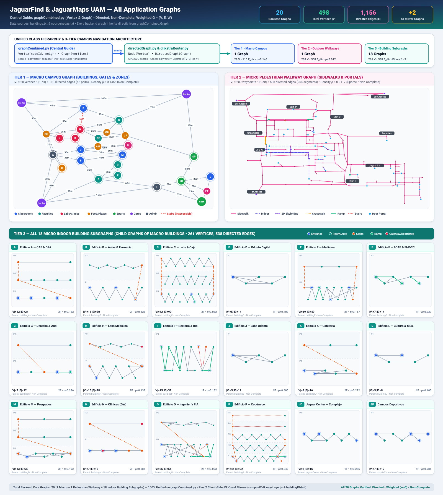
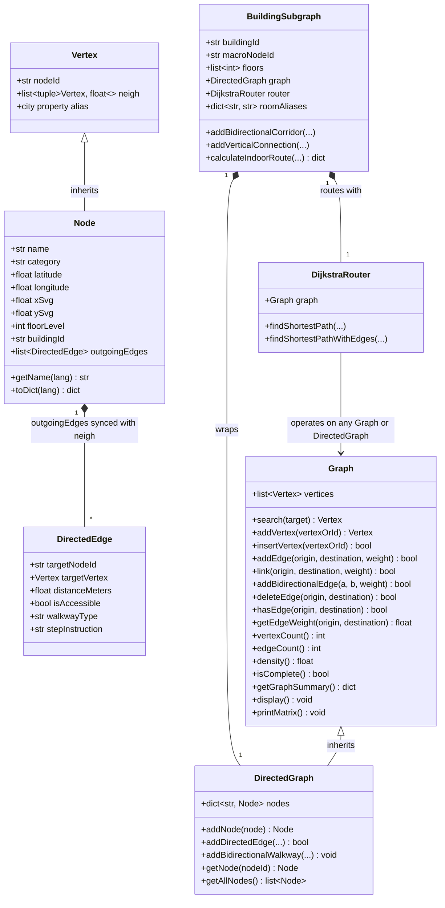
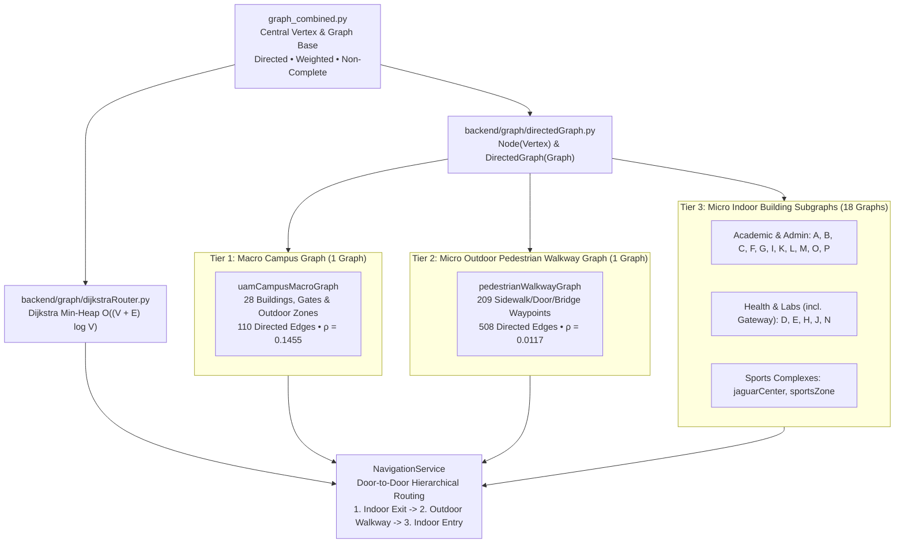

# Campus Graph Structures & Central Architecture (`graph_combined.py`)
**JaguarFind & JaguarMaps — Universidad Americana (UAM)**  
*Unified Documentation of All Weighted, Directed, Non-Complete Graphs*

---

## 1. Executive Summary & Total Graph Count

Every graph in the JaguarFind & JaguarMaps backend is built directly on top of **`graph_combined.py`** (`Vertex` and `Graph`) as its single central data structure: a **Directed, Non-Complete, Weighted Graph** $G = (V, E, W)$.

### How Many Graphs Does the App Use?

| Layer / Role | Graph Count | Total Vertices $\|V\|$ | Total Directed Edges $\|E_{\text{dir}}\|$ | Powered By |
| :--- | :---: | :---: | :---: | :--- |
| **Tier 1 — Macro Campus Graph** (Buildings, Gates & Outdoor Zones) | **1** | 28 | 110 | `graph_combined.Graph` -> `DirectedGraph` |
| **Tier 2 — Micro Outdoor Pedestrian Walkway Graph** (Sidewalks, Doors, Crosswalks, 2P Skybridges) | **1** | 209 | 508 | `graph_combined.Graph` -> `DirectedGraph` |
| **Tier 3 — Micro Indoor Building Subgraphs** (Classrooms, Labs, Annexes, Restrooms, Floors 1–5) | **18** | 261 | 538 | `graph_combined.Graph` -> `DirectedGraph` -> `BuildingSubgraph` |
| **Total Backend Core Graphs (Single Source of Truth)** | **20** | **498** | **1,156** | **100% Unified on `graph_combined.py`** |
| *Frontend UI Visual / Viewer Mirrors (Client-Side JS)* | *+2* | *Sync* | *Sync* | `campusWalkwaysLayer.js` & `buildingP_3d_model/buildingP.html` |

> **Summary Answer:** The application uses **20 backend core Python graphs** (1 Macro + 1 Micro Pedestrian Walkway + 18 Micro Indoor Building Subgraphs), all inheriting from `graph_combined.Graph`, plus **2 synchronized client-side JS visual mirrors** used purely for interactive browser SVG/3D rendering (22 graph representations total across backend + frontend).

---

## 2. Visual Graphic of All Application Graphs

The full live vector graphic below is generated directly from the 20 active `graph_combined.Graph` instances via [`scripts/generateGraphDiagram.py`](../scripts/generateGraphDiagram.py):



To regenerate the graphic at any time after updating campus buildings or walkways:

```bash
python3 scripts/generateGraphDiagram.py
```

---

## 3. Formal Mathematical Model: $G = (V, E, W)$

All 20 backend graphs satisfy the exact three formal properties defined by the course specification and enforced by `graph_combined.py`:

1. **Directed ($E \subseteq V \times V$):**
   - Every edge is an ordered pair $(u \to v)$ stored inside the origin vertex's outgoing adjacency list `u.neigh: list[tuple[Vertex, float]]`.
   - Bidirectional walkways, hallways, and staircases are modeled as two antiparallel directed edges $(u \to v)$ and $(v \to u)$, preserving directional semantics (e.g., *up stairs* vs. *down stairs*, *enter building* vs. *exit building*, or future one-way gates).
2. **Weighted ($W: E \to \mathbb{R}^+$):**
   - Every directed edge carries a strictly positive weight $w(u, v) > 0$ representing real physical walking distance in meters, calibrated from field GPS measurements in [`coordenadas.txt`](../coordenadas.txt) via the Haversine formula and calibrated affine SVG projection.
   - `Graph.addEdge()` rejects any non-positive weight ($w \le 0$).
3. **Non-Complete ($|E| < |V|(|V|-1)$, sparse topology):**
   - No self-loops ($u \neq v$) and no duplicate parallel edges between the same $(u, v)$ pair are allowed.
   - Edges exist only along genuinely walkable physical segments, respecting walls, barriers, and restricted perimeters (Rule 1 — *The Gateway Pattern*).
   - Every single graph has density $\rho = \frac{|E|}{|V|(|V|-1)} < 1.0$ (ranging from $\rho = 0.0117$ on the Walkway Graph to $\rho = 0.7000$ on the compact 5-node Building D lobby).

---

## 4. `graph_combined.py` as the Central Guide & Class Hierarchy

[`graph_combined.py`](../graph_combined.py) defines the teacher-recommended core abstractions (`Vertex` and `Graph`), and every campus graph module extends them without duplicating core graph logic:



### Synchronization Guarantee
Whenever an edge is added via `addEdge()`, `link()`, `addDirectedEdge()`, or `addBidirectionalWalkway()` on a `DirectedGraph`:
1. `super().addEdge(v_origin, v_destination, distance)` validates invariants (both vertices exist, no self-loops, $w > 0$, no duplicate edges) and appends `(v_destination, distance)` to `v_origin.neigh`.
2. A matching `DirectedEdge` with accessibility, `walkwayType`, and i18n metadata is appended to `v_origin.outgoingEdges`.
3. `deleteEdge()` removes the connection from **both** `v_origin.neigh` and `v_origin.outgoingEdges`.

As a result, every graph in JaguarFind supports **both** the teacher's exact `Graph` API (`search`, `addVertex`, `insertVertex`, `addEdge`, `link`, `deleteEdge`, `display`, `printMatrix`) **and** the full JaguarMaps routing/i18n/accessibility engine.

---

## 5. Three-Tier Hierarchical Navigation Architecture

Data from [`buildings.txt`](../buildings.txt) (rooms, annexes, labs, restrooms, fountains, floors) and [`coordenadas.txt`](../coordenadas.txt) (field-measured WGS84 GPS coordinates) is organized into three cooperating graph tiers orchestrated by [`backend/graph/navigationService.py`](../backend/graph/navigationService.py):



### How Door-to-Door Routing Works
When a student routes from e.g. **`A101` (Building A, Floor 1)** to **`CIAR` (Building O, Floor 2)**:
1. **Origin Indoor Leg (Tier 3 — `buildingASubgraph`):** Dijkstra computes the shortest indoor path from `a_contabilidad_101` to the best exterior portal of Building A.
2. **Outdoor Walkway Leg (Tier 2 — `pedestrianWalkwayGraph`):** Dijkstra evaluates valid `BUILDING_PORTALS` between Building A and Building O over real sidewalks, doors, crosswalks, ramps, and 2nd-floor covered skybridges (pruning `isAccessible = False` edges when wheelchair mode is active).
3. **Destination Indoor Leg (Tier 3 — `buildingOSubgraph`):** Dijkstra guides the user from the optimal Building O entrance up the stairs to Floor 2 (`o_ciar`).
4. **Macro Context (Tier 1 — `uamCampusMacroGraph`):** Provides high-level building-to-building metadata, access notices (e.g., Building N biosecurity *Gateway Pattern*), and 2D/2.5D map compatibility.

---

## 6. Complete Inventory of All 20 Backend Graphs

All metrics below are verified programmatically via [`backend/graph/graphRegistry.py`](../backend/graph/graphRegistry.py) and live endpoint `GET /api/map/graphs-summary`.

| # | Graph ID | Tier | Parent Building | Floors | $\|V\|$ | $\|E_{\text{dir}}\|$ | Max $\|V\|(\|V\|-1)$ | Density $\rho$ | Complete? | Base Class |
| :-: | :--- | :--- | :--- | :---: | :---: | :---: | :---: | :---: | :---: | :--- |
| 1 | `uamCampusMacroGraph` | Macro | — | 1 | 28 | 110 | 756 | 0.14550 | No | `graph_combined.Graph` |
| 2 | `pedestrianWalkwayGraph` | Micro Outdoor | — | 1, 2 | 209 | 508 | 43,472 | 0.01169 | No | `graph_combined.Graph` |
| 3 | `subgraph_buildingA` | Micro Indoor | `buildingA` | 1–3 | 12 | 24 | 132 | 0.18182 | No | `graph_combined.Graph` |
| 4 | `subgraph_buildingB` | Micro Indoor | `buildingB` | 1–2 | 16 | 30 | 240 | 0.12500 | No | `graph_combined.Graph` |
| 5 | `subgraph_buildingC` | Micro Indoor | `buildingC` | 1–3 | 42 | 90 | 1,722 | 0.05226 | No | `graph_combined.Graph` |
| 6 | `subgraph_buildingD` | Micro Indoor | `buildingD` | 1 | 5 | 14 | 20 | 0.70000 | No | `graph_combined.Graph` |
| 7 | `subgraph_buildingE` | Micro Indoor | `buildingE` | 1–2 | 19 | 40 | 342 | 0.11696 | No | `graph_combined.Graph` |
| 8 | `subgraph_buildingF` | Micro Indoor | `buildingF` | 1 | 7 | 14 | 42 | 0.33333 | No | `graph_combined.Graph` |
| 9 | `subgraph_buildingG` | Micro Indoor | `buildingG` | 1–2 | 7 | 12 | 42 | 0.28571 | No | `graph_combined.Graph` |
| 10 | `subgraph_buildingH` | Micro Indoor | `buildingH` | 1–2 | 15 | 28 | 210 | 0.13333 | No | `graph_combined.Graph` |
| 11 | `subgraph_buildingI` | Micro Indoor | `buildingI` | 1 | 15 | 32 | 210 | 0.15238 | No | `graph_combined.Graph` |
| 12 | `subgraph_buildingJ` | Micro Indoor | `buildingJ` | 1 | 5 | 12 | 20 | 0.60000 | No | `graph_combined.Graph` |
| 13 | `subgraph_buildingK` | Micro Indoor | `buildingK` | 1–2 | 9 | 16 | 72 | 0.22222 | No | `graph_combined.Graph` |
| 14 | `subgraph_buildingL` | Micro Indoor | `buildingL` | 1 | 5 | 8 | 20 | 0.40000 | No | `graph_combined.Graph` |
| 15 | `subgraph_buildingM` | Micro Indoor | `buildingM` | 1–3 | 13 | 30 | 156 | 0.19231 | No | `graph_combined.Graph` |
| 16 | `subgraph_buildingN` | Micro Indoor | `buildingN` | 1–2 | 7 | 12 | 42 | 0.28571 | No | `graph_combined.Graph` |
| 17 | `subgraph_buildingO` | Micro Indoor | `buildingO` | 1–2 | 25 | 56 | 600 | 0.09333 | No | `graph_combined.Graph` |
| 18 | `subgraph_buildingP` | Micro Indoor | `buildingP` | 1–5 | 44 | 92 | 1,892 | 0.04863 | No | `graph_combined.Graph` |
| 19 | `subgraph_jaguarCenter` | Micro Indoor | `jaguarCenter` | 1 | 8 | 16 | 56 | 0.28571 | No | `graph_combined.Graph` |
| 20 | `subgraph_sportsZone` | Micro Indoor | `sportsZone` | 1 | 7 | 12 | 42 | 0.28571 | No | `graph_combined.Graph` |
| — | **TOTAL (20 Backend Graphs)** | **3 Tiers** | **18 Child Buildings** | **1–5** | **498** | **1,156** | — | **All < 1.0** | **0 / 20** | **100% Unified** |

> **Note on Outdoor Open Zones from `buildings.txt` / `coordenadas.txt`:** Open-air spaces without enclosed rooms (`chilamatesPlaza`, `jaguarJungle`, `miRanchito`, `labDigitalFia`, `areaDeMesas`, `bodega`/`comedor` eastern alley, and the 3 campus gates) are modeled directly as vertices inside the **Macro Campus Graph** and high-resolution walkways inside the **Micro Pedestrian Walkway Graph**.
>
> **Note on Restricted Clinical Zones (`buildingN`):** Per [`GRAPH_MAPPING_RULES.md`](GRAPH_MAPPING_RULES.md) (Rule 1 — *Gateway Pattern*), sterile clinical suites (operating rooms, sterilization, radiology, tomography) route safely to Public Reception (`n_reception`) and FODO Reception (`n_fodo_f2_reception`) with an automatic biosecurity `accessNotice`.

### Frontend Client-Side UI Mirror Graphs (+2)
- [`frontend/static/js/campusWalkwaysLayer.js`](../frontend/static/js/campusWalkwaysLayer.js): Synchronized JS visual mirror of the Pedestrian Walkway Graph used to render the toggleable SVG walkways/barriers layer and fallback polyline geometry.
- [`buildingP_3d_model/buildingP.html`](../buildingP_3d_model/buildingP.html): Embedded local indoor graph for the standalone 3D isometric Building P viewer.

---

## 7. Summary of All Improvements Made

All changes were designed to stay **simple, modular, and strictly non-breaking** (zero regressions across existing tests, APIs, and GPS matching):

1. **Unified Core Data Structure on `graph_combined.py`:**
   - Enhanced [`graph_combined.py`](../graph_combined.py) as the central base module (`Vertex` and `Graph`) while preserving every teacher-recommended method (`search`, `addVertex`, `insertVertex`, `addEdge`, `link`, `deleteEdge`, `display`, `printMatrix`) and attribute (`vertices`, `neigh`, `city` alias).
   - Added $O(1)$ case-insensitive vertex indexing inside `Graph.search()` (with safe linear fallback), strict invariants rejecting self-loops, non-positive weights ($w \le 0$), and duplicate directed edges, plus modular introspection helpers (`addBidirectionalEdge`, `hasEdge`, `getEdgeWeight`, `vertexCount`, `edgeCount`, `density`, `isComplete`, `getGraphSummary`).
2. **Direct Inheritance in `DirectedGraph` & `Node`:**
   - Refactored [`backend/graph/directedGraph.py`](../backend/graph/directedGraph.py) so `Node(Vertex)` inherits from `graph_combined.Vertex` and `DirectedGraph(Graph)` inherits from `graph_combined.Graph`.
   - Kept `self.vertices` $\leftrightarrow$ `self.nodes` and `vertex.neigh` $\leftrightarrow$ `node.outgoingEdges` in strict 1:1 synchronization across `addVertex`, `addNode`, `addEdge`, `addDirectedEdge`, `link`, and `deleteEdge`.
3. **General-Purpose & Faster `DijkstraRouter`:**
   - Upgraded [`backend/graph/dijkstraRouter.py`](../backend/graph/dijkstraRouter.py) so it runs seamlessly on both rich `DirectedGraph` instances (with accessibility filtering) and standalone `graph_combined.Graph` instances.
   - Improved path reconstruction from $O(|V|^2)$ (`path.insert(0, ...)`) to $O(|V|)$ (`path.append(...)` + `path.reverse()`).
4. **Building Subgraph Standardization & Bug Fixes:**
   - Updated [`backend/subgraphs/buildingSubgraph.py`](../backend/subgraphs/buildingSubgraph.py) to automatically assign `node.buildingId = self.macroNodeId` on every indoor node (fixing **121 nodes** across Buildings C, D, J, O, and P that previously had `buildingId = None`).
   - Added semantic `walkwayType` tagging (`"indoor"` for corridors, `"stairs"` / `"ramp"` for vertical connections) and delegated `graph_combined.Graph` methods (`search`, `addVertex`, `insertVertex`, `addEdge`, `link`, `deleteEdge`, `display`, `printMatrix`, `getGraphSummary`) directly on `BuildingSubgraph`.
   - Eliminated **16 duplicated `_calcDist` functions** across `backend/subgraphs/*.py` by introducing shared `calcIndoorDistance()` and `makeIndoorDistanceCalculator()` helpers.
   - Fixed a room-resolution bug in [`backend/subgraphs/buildingP.py`](../backend/subgraphs/buildingP.py) where searching `"observatorio"` matched Floor 5 stairs (`p_stairs_f5_east`) instead of the Copernicus Observatory (`p_observatory_501`), and added standard Building P aliases.
5. **Central Graph Inventory, Exports & Read-Only Endpoint:**
   - Added [`backend/graph/graphRegistry.py`](../backend/graph/graphRegistry.py) (`getAllApplicationGraphs()`, `getGraphsInventory()`) for live counting and formal verification of all 20 graphs.
   - Fixed stale re-exports in [`backend/children_graphs/__init__.py`](../backend/children_graphs/__init__.py) (previously exported only 5 of 18 subgraphs; now exports all 18) and exported `Vertex` & `Graph` in [`backend/graph/__init__.py`](../backend/graph/__init__.py) and [`graphUam.py`](../graphUam.py).
   - Added read-only endpoint `GET /api/map/graphs-summary` and enriched `/api/map/subgraphs` with `totalDirectedEdges`, `density`, and `isComplete` metrics in [`backend/controllers/mapController.py`](../backend/controllers/mapController.py).
6. **Live Graphic Generator & Comprehensive Verification:**
   - Added [`scripts/generateGraphDiagram.py`](../scripts/generateGraphDiagram.py) to generate [`docs/campus_graphs_diagram.svg`](campus_graphs_diagram.svg) directly from live graph data with zero third-party dependencies.
   - Added automated verification tests in [`testCampusGraph.py`](../testCampusGraph.py) covering `graph_combined.py` standalone invariants, inheritance across all 20 graphs, `neigh`/`outgoingEdges` sync, `DijkstraRouter` on raw `Graph`, `buildingId` ownership, and Flask API endpoints.

---

## 8. Quick Usage Examples

### Inspecting Any Graph Using the Teacher's `graph_combined.py` Interface

```python
from graphUam import globalNavigationService, getBuildingSubgraph, getGraphsInventory

# 1. Inspect the Macro Campus Graph using graph_combined.Graph methods
macro = globalNavigationService.graph
print(macro.search("buildingA"))           # Case-insensitive Vertex lookup
print(macro.getEdgeWeight("buildingA", "buildingC"))  # 30.0
print(macro.getGraphSummary())

# 2. Inspect any Building Subgraph (e.g. Building D — 5 nodes)
sgD = getBuildingSubgraph("buildingD")
sgD.display()      # Prints adjacency list from graph_combined.Graph
sgD.printMatrix()  # Prints weighted adjacency matrix ('-' for absent edges)

# 3. Live count & formal verification of all 20 backend graphs
inventory = getGraphsInventory()
print(inventory["totalBackendGraphs"])     # 20
print(inventory["totals"])                 # {'vertices': 498, 'directedEdges': 1156, ...}
```

### REST API Endpoint
- `GET /api/map/graphs-summary` — Returns the live JSON inventory, graph count breakdown, vertex/edge totals, and formal verification flags for all 20 graphs.
