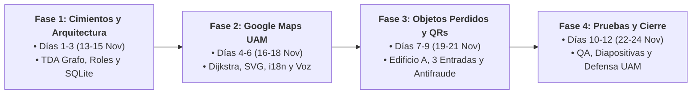

# Team Planning & 12-Day Roadmap / Planificación del Equipo y Cronograma

---

<b>🇪🇸 Versión en Español</b>

### 1. Asignación de Roles del Equipo
* **Br. Camila Navarro (Rol 1):** TDA Grafo en Python puro, algoritmo de Dijkstra con cola de prioridad `heapq`, filtro accesible para sillas de ruedas ♿ y pruebas unitarias.
* **Br. Francis Solórzano (Rol 2):** Base de datos SQLite3 con roles de usuario (estudiante con doble titulación, colaborador, admin), validaciones regex y capa DAO.
* **Br. James Fernandez (Rol 3):** Frontend responsivo con Tailwind CSS, internacionalización bilingüe (`languages/`), trazado de rutas SVG y Web Speech API para voz.
* **Br. Elias Solis (Rol 4):** Tablero de tickets del Edificio A, verificación antifraude, panel de asignación de roles y Códigos QR para las 3 entradas.

---

### 2. Matriz RACI
* **R:** Responsable de ejecución • **A:** Aprobador final • **C:** Consultado • **I:** Informado

| Tarea / Entregable | Camila Navarro | Francis Solórzano | James Fernandez | Elias Solis |
| :--- | :---: | :---: | :---: | :---: |
| **Modelado del Grafo (3 Entradas, Aulas, Baños, Comida)** | **R / A** | C | C | I |
| **Dijkstra con Cola de Prioridad y Filtro Accesible ♿** | **R / A** | C | I | I |
| **Base de Datos SQLite3 con Roles y Doble Titulación** | C | **R / A** | I | C |
| **Validaciones Regex (CIF, Clave, Correo @uamv.edu.ni)** | I | **R / A** | C | C |
| **Panel de Asignación de Rol Administrador** | I | **R** | C | **R / A** |
| **Sistema Bilingüe i18n y Voz Web Speech API** | I | C | **R / A** | I |
| **Tablero Cards Edificio A y Validación Antifraude** | I | C | C | **R / A** |
| **Códigos QR para las 3 Entradas al Campus** | I | I | C | **R / A** |
| **Pruebas Unitarias y Demostración Final** | **R** | **R** | **R** | **R / A** |

---

### 3. Cronograma de 12 Días

| Fase | Días | Tareas Específicas | Responsable | Entregables |
| :--- | :--- | :--- | :--- | :--- |
| **Fase 1: Cimientos** | **Días 1-3** | Clases `Nodo`/`Arista`/`GrafoUam`, 3 accesos, aulas B101-B106, baños, DB SQLite con roles y regex. | Camila Navarro Francis Solórzano | Grafo y DB listos y probados. |
| **Fase 2: Mapa UAM** | **Días 4-6** | Dijkstra con filtro accesible ♿, i18n bilingüe, trazado SVG y narración Web Speech API. | Camila Navarro James Fernandez | Navegador peatonal operativo con voz. |
| **Fase 3: Objetos y QRs** | **Días 7-9** | Formulario con GPS, tablero de tickets Edificio A, validación antifraude y QRs en 3 casetas. | Elias Solis Francis Solórzano | Módulo de objetos perdidos completo. |
| **Fase 4: Cierre** | **Días 10-12** | Pruebas unitarias (`pytest`), ensayo de demostración y defensa ante el jurado de la UAM. | Todo el Equipo | Proyecto finalizado y defendido. |

---

<b>🇺🇸 English Version</b>

### 1. Team Role Allocation
* **Camila Navarro (Role 1):** Graph ADT, Dijkstra algorithm with priority queue, accessible route filter, and unit testing.
* **Francis Solórzano (Role 2):** SQLite3 schema with user roles (double degree students, collaborators, admin), regex checks, and DAO layer.
* **James Fernandez (Role 3):** Responsive Tailwind CSS UI, bilingual i18n, SVG route overlay, and Web Speech API.
* **Elias Solis (Role 4):** Building A custody cards, anti-fraud verification, role delegation, and gate QR codes.

---

### 2. 12-Day Development Roadmap
* **Phase 1 (Days 1-3):** Graph layout with 3 gates, classrooms, and bathrooms; SQLite user roles and database schema.
* **Phase 2 (Days 4-6):** Dijkstra shortest path algorithm with accessible ♿ filter; interactive SVG route overlay and browser voice narration.
* **Phase 3 (Days 7-9):** Found item reporting with GPS; Building A custody dashboard and QR codes for all 3 campus gates.
* **Phase 4 (Days 10-12):** Pytest test suite, presentation slide deck, and live defense before the UAM jury.

